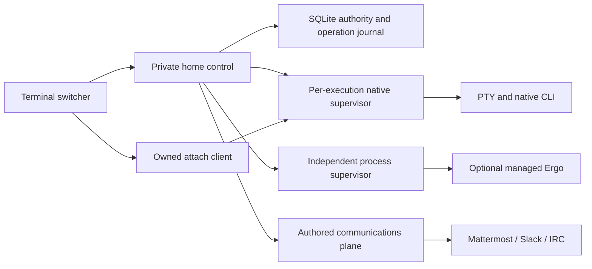

# 0002: Own the native runtime lifetime

Status: accepted by the owner on 2026-10-10; implemented in the development branch, release qualification in progress.

Keelmux owns persistent PTYs and foreground process lifetimes. It does not require tmux to create a session or operate its managed IRC server. Published v0.1.0 remains a historical tmux release; its running executions keep their original adapter and authority.

## Boundaries

The home daemon owns stable host/work/thread/lane identity, durable operations, cooperating attachment grants and channel messages. A detached `keelmux-supervisor` owns one execution's PTY or foreground service, authenticated local socket, child process handle, terminal tracker and bounded output ring. Vendor CLIs retain their own conversation, login and permissions. Optional tmux compatibility resolves previously recorded tmux executions; it cannot become a fallback for failed native launches.

Client loss and control-daemon loss do not own the child lifetime. Host reboot or supervisor loss are explicit recovery boundaries. A missing helper is an unknown outcome, never proof of child exit and never permission to start another execution.

## Exact authority and side effects

Launch persists and fsyncs an immutable operation/content receipt before spawning the helper. The helper consumes that intent before starting the child. Launch arguments and environment values travel through an inherited pipe; only their digests and resolved executable are retained. Repeating an attempted operation reconciles that original execution. Conflicting content, unknown outcomes and completed attempts cannot start another child.

References bind execution/operation IDs, a random supervisor instance, exact private socket, child PID/start and host boot. Kernel peer credentials and supervisor PID/start independently verify the connection. Stop addresses the authenticated helper and its retained direct child process handle, rather than a saved PID or process group. Files are private and opened without following symlinks; nonblocking opens reject special-file traps before reads.

An attach helper enters raw mode before the home confirms its actual peer PID/start and grants input readiness. The runtime enforces one cooperating writer independently of the registry grant. Read-only clients cannot write or resize. Disconnect fences admitted input before releasing the writer; reconnect never replays input.

## Terminal state

A terminal query has one authority: the supervisor's pinned streaming emulator. Supported queries are answered under the PTY input lock, including before a viewer attaches. Viewers receive filtered live terminal controls and a freshly generated visible-screen snapshot. Historical output is not replayed as terminal commands. OSC, DCS and other string controls cannot trigger clipboard, title, hyperlink or graphics effects on reconnection.

Streaming parser state and a bounded grapheme tail survive arbitrary PTY read boundaries. Snapshots restore qualified Unicode cells, styles, cursor, wrap and selected terminal modes. Inactive buffers, saved cursor stacks, graphics, advanced keyboard protocols and application scrollback remain outside the qualified restoration contract. Provider-specific readiness and reconnect tests remain separate release gates.

## Tradeoffs and evidence

One helper per execution makes lifetime and failure boundaries simple and isolates a failed tracker. It adds measurable per-session memory and process overhead; the initial ordinary macOS build observed roughly 13 MiB for an idle PTY helper and 12 MiB for a process helper. Those observations are not a load guarantee. A future shared supervisor requires measured scale evidence and must preserve the same authority and recovery contract.

Deterministic tests use actual helper processes and PTYs, control-process SIGKILL, exact stop, writer/read-only enforcement, Unicode, resize, Ctrl-C, detach, bounded readers, safe query handling and private-file refusal. Real pinned Ergo has separate native-supervisor persistence evidence. Compiler success does not qualify another OS, native CLI or workload. Final release receipts name their exact source and artifact digests.

The owner instruction supersedes tmux-first implementation details in the imported product/build snapshots. Preserve those source documents as historical requirements context; this decision and the current support matrix describe the active architecture.
