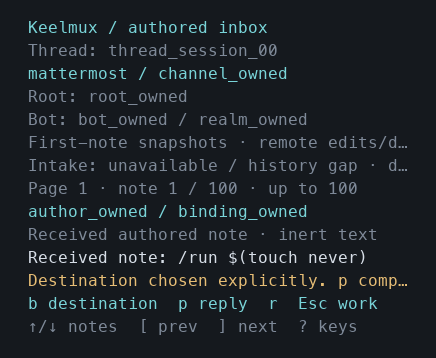
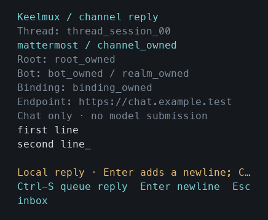
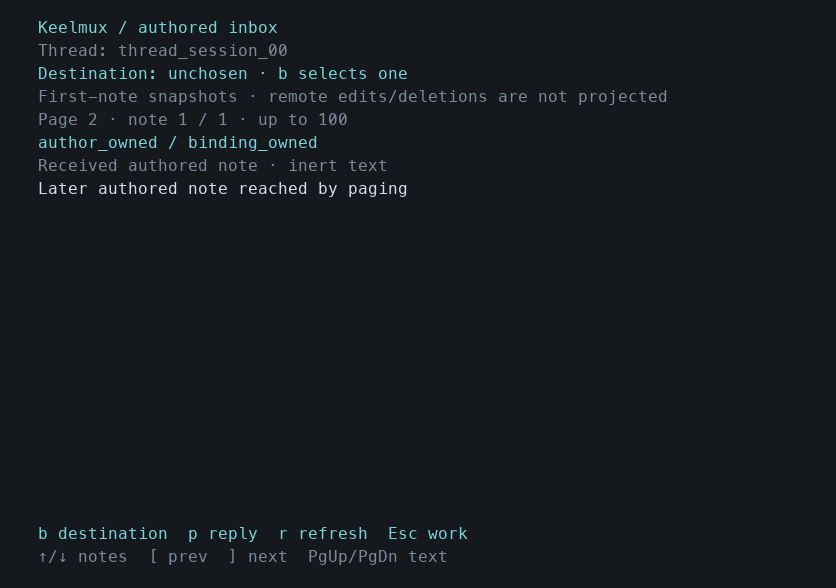
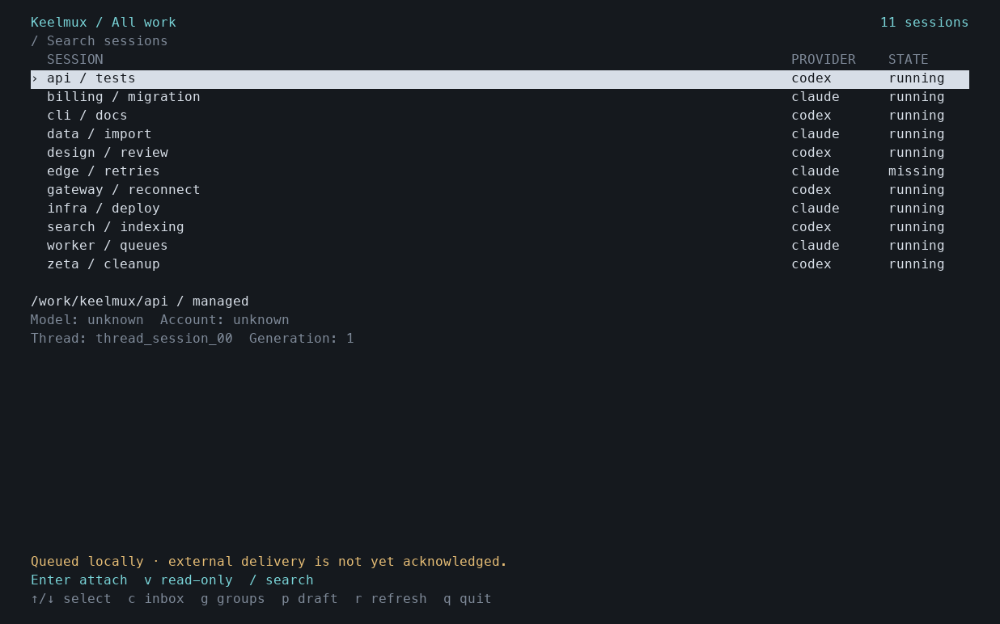

# Authored inbox and explicit reply evidence

Tested source: `d73c3fbb3b45793c5d0b0cc304b19bedf5aaab1f`, clean when built on macOS 26.7.1 (25G309), arm64, Go 1.26.6. The [machine receipt](channel-inbox.json) records source-file, binary, helper, test-log and image hashes. This is development evidence; v0.1.0 and its release assets are unchanged.

`c` opens the selected stable thread's authored inbox. `b` explicitly chooses one active destination; `p` opens its separate channel draft. The view shows provider, endpoint, realm, bot, channel/root and intake evidence. Intake freshness or gaps remain distinct from delivery receipts. Received text stays inert. Enter adds a newline; Ctrl-S persists one immutable message/thread/binding/text intent before requesting a local queue entry. Native drafts, groups, selection and attachment intents remain separate.

A lost local acknowledgement retains the exact intent. Startup and refresh query its existing receipt. Only an explicit Ctrl-S recovery after a scoped not-found response may retry the same ID/content against the same active immutable destination. A known queued/attempted/failed/uncertain/delivered receipt never causes another send. Exact IDs and the shared payload hash must match before clearing the draft/intent. A disabled historical binding may resolve an already queued operation. Delivered means an external post receipt, never model acceptance; uncertain reconciliation is read-only.

`[` and `]` move through bounded local history pages of up to 100 notes. Page requests capture thread, cursor and request epoch; stale responses and sequences at or below the requested cursor are refused. Paging preserves the explicitly chosen binding and draft. PgUp/PgDn scroll the complete selected note; `?` lists receipt/reconciliation controls. The interface labels first-note snapshots because remote edits/deletions are not projected.

Client state migrates v1 to v2 while preserving existing fields. Old clients refuse v2. The reader rejects unknown or duplicate fields, ASCII/Unicode case aliases, invalid UTF-8, oversized/trailing data and ambiguous v1 channel-field presence even when null/empty. Schema keys must be ASCII lowercase; dynamic Places IDs retain their case-sensitive identity. State and lifetime-lock descriptors refuse symlinks, FIFOs, directories, unsafe permissions and foreign ownership, with nonblocking/no-follow/close-on-exec opens. Refusal preserves existing bytes and permissions.

`go test -race -json ./internal/tui ./internal/clientstate ./cmd/bp` passed **42 top-level groups / 46 nodes**: 26 TUI, 13 client-state groups / 17 nodes, and 3 CLI groups. Relevant vet and diff checks passed. New cases exercise explicit choice, wrong-thread/history/binding rejection, stale refresh and page results, disabled or changed preflight destinations, lost response, same-ID recovery, hash/ID/state mismatches, immutable edits, restart, failed local persistence, inert received text, ANSI/control/bidi safety, resize, diagnostic-only intake changes, long note scrolling, and 102-note pagination including a later outgoing receipt. The new refusal regression fails against an overlay of pre-repair `533fcd0` client-state source as expected.

The actual published darwin/arm64 v0.1.0 binary (source `60b8bc705b2636b087bf2fd872e976aa466ad3e9`, archive SHA-256 `63bbee14e22d7468feb6f6971b48626b409e07e131b78d7941440d8bd5995243`) was separately run against an owned v2 pending file and Unix fixture. It exited 1 with unsupported version 2, left the file byte-identical, made zero mutating calls and removed its owned test state.

Actual CLI/Bubble Tea PTYs passed **24 captures** at 80×24, 120×32 and 40×14. Each viewport opened inert notes, reached note 101 with `]`, restored the earlier page with `[`, chose a destination, composed two lines, sent one local fixture request after durable intent persistence, retained a deliberately lost acknowledgement, refused editing the frozen intent, quit and restarted, then queried the exact receipt without reposting. Native draft and session selection survived. Every final process exited through `q` at zero without signals; every owned temporary state/socket was removed. There were three total local fixture queue requests, zero external posts, zero native CLI/model activity and no user-terminal changes.

CUA's prior Terminal request was denied: **“Computer Use is not allowed to use the app 'com.apple.Terminal' for safety reasons.”** These PNGs rasterize interpreted actual PTY cells with Menlo and authored color mappings. They are **not native Terminal screenshots**. The protocol fixture retains its simulated queue in memory across TUI restarts; this establishes client intent persistence and wire/recovery behavior, not real service database or external adapter delivery. Linux rendering, general emulator conformance, native-provider behavior on this source, foreign-UID negative file fixtures and entry/federated inbox routing were not established here.

Narrow selected inbox and reply:

Later local history and restart recovery:

All eight captured states are retained for each viewport under `internal/tui/testdata/channel_visual/`, with text cell transcripts. Initial diagnostics retained privately include an unsynchronized fixture read, an unsettled fixture loading state and a clipped narrow destination label; corrected final runs passed. The initial narrow diagnostic has no complete dirty-source fingerprint and is excluded from exact-source qualification.

Reproduce the PTY flow with `internal/tui/testdata/capture_channels.py --binary ABSOLUTE_BUILD --output OWNED_OUTPUT`. Text/raw captures use Python's standard library; PNGs require optional Pillow and the stated font. The captain must record the integrated source after cherry-picking these owned changes and perform broader service/adapter gates. This worker made no public push or release change.
