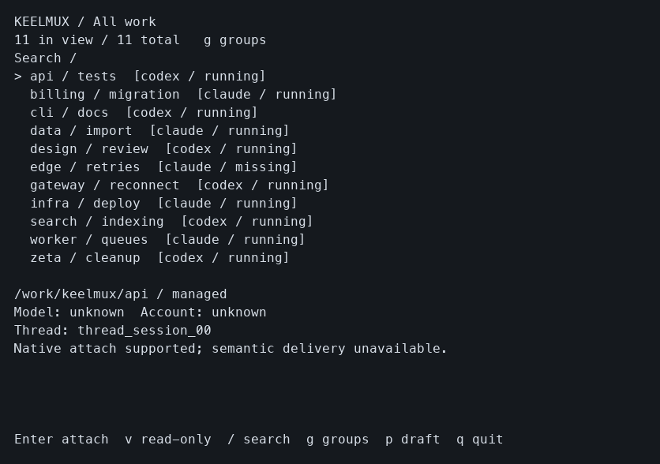
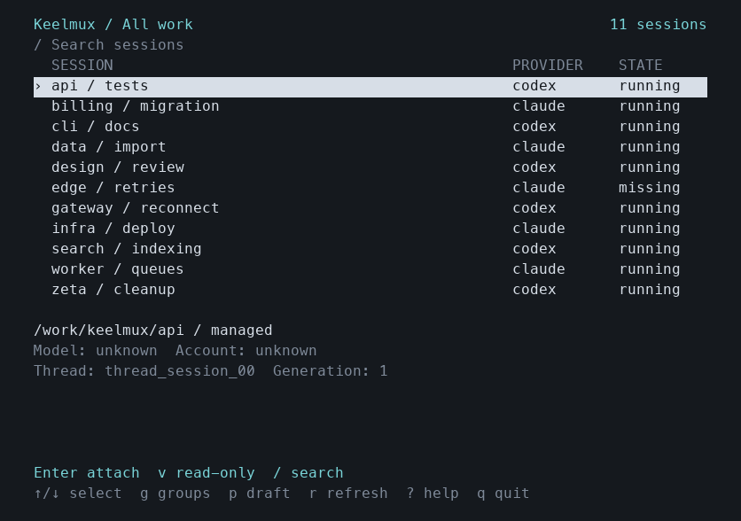
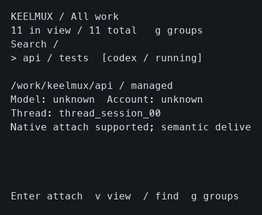
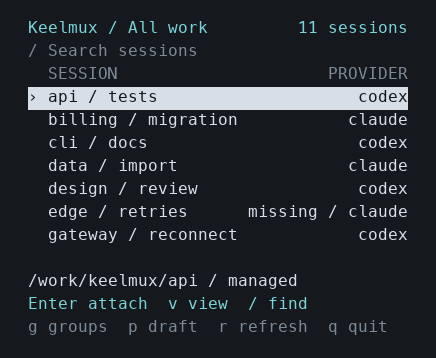

# Switcher layout evidence

Tested implementation: `f15340ad156c4985af78003d3c89b63aa7c0fd78`, based on the unchanged v0.1.0 source `60b8bc705b2636b087bf2fd872e976aa466ad3e9`. This is a later development change, not a release update. The [machine receipt](tui-polish.json) records exact binary, helper, capture and image hashes.

The switcher now uses aligned provider/state columns, a restrained cyan/gray palette, an inverse selected row, and a compact workspace/identity summary. It honors `NO_COLOR` and a dumb terminal. Narrow views reserve room for the current action and show several sessions; the actual 40×14 inventory grew from one visible row to seven. Recovery retains the original pending intent and shows its retry/release action alongside offline status. Input handlers, addressed drafts, groups, lease acquisition/release and stored identities remain unchanged.

Inventory and status text are sanitized before trusted styling. Only a finite SGR palette enters the view. Control bytes and bidi reordering controls cannot supply terminal instructions; grapheme-aware clipping preserves cell width. The context footer hides unsupported read-only attachment actions.

Actual CLI/Bubble Tea output was captured through owned PTYs at 80×24, 120×32 and 40×14, with deterministic inventory on private Unix HTTP sockets. Empty, offline, groups and local-draft states were also captured at 80×24. Every final capture observed only `GET /v1/sessions`, exited with `q` at status zero without signals, and removed its owned temporary state. No product daemon, tmux server, provider CLI, model work or user terminal was launched or changed.

CUA returned **“Computer Use is not allowed to use the app 'com.apple.Terminal' for safety reasons.”** The following images rasterize interpreted cells from the actual PTY bytes using Menlo, with authored color mappings. They are **not native Terminal screenshots**. Native fonts/themes/contrast, general emulator conformance, Linux rendering and native attachment behavior on this new source are not established by these images. The existing ExecProcess regression remains process-handoff/lease plumbing evidence.

Before and after at 80×24:

Before and after at 40×14:

Other captured states:

| Actual PTY viewport | Baseline cells | Polished cells |
| --- | --- | --- |
| Inventory 120×32 | [Before](../../internal/tui/testdata/visual/before-inventory-120x32.png) | [After](../../internal/tui/testdata/visual/after-inventory-120x32.png) |
| Empty 80×24 | [Before](../../internal/tui/testdata/visual/before-empty-80x24.png) | [After](../../internal/tui/testdata/visual/after-empty-80x24.png) |
| Offline 80×24 | [Before](../../internal/tui/testdata/visual/before-offline-80x24.png) | [After](../../internal/tui/testdata/visual/after-offline-80x24.png) |
| Groups 80×24 | [Before](../../internal/tui/testdata/visual/before-groups-80x24.png) | [After](../../internal/tui/testdata/visual/after-groups-80x24.png) |
| Local draft 80×24 | [Before](../../internal/tui/testdata/visual/before-draft-80x24.png) | [After](../../internal/tui/testdata/visual/after-draft-80x24.png) |

`go test -race -json ./internal/tui ./internal/clientstate ./cmd/bp` passed all 14 TUI, 6 client-state and 3 CLI tests. Relevant vet passed. New tests cover 48 color/monochrome layouts across four screens and six sizes, ANSI cell width with wide graphemes, control/bidi safety, exact selected-row visibility through resize, offline pending-release visibility, and persisted group/filter/draft addressing. Existing tests cover lost attachment acknowledgement, strict lease identity, exact release, missing anchors and process handoff.

The first capture-helper attempts exposed batched shortcut/text input, a premature fixed-delay assertion, and a blocked PTY during teardown. The final helper waits for the requested rendered state, separates shortcut/text input, continuously drains exit output and verifies signal-free shutdown. Only verified still-owned helper children were stopped during diagnosis; final captured runs required no signals.

Reproduce the cell captures with `internal/tui/testdata/capture.py --binary ABSOLUTE_BUILD --output OWNED_OUTPUT_DIR`. Text/raw captures use Python's standard library; the optional PNG renderer requires Pillow and the stated macOS font. The fixture does not substitute for a native provider/runtime acceptance matrix. No branch was pushed by this worker, and no release file was changed.
