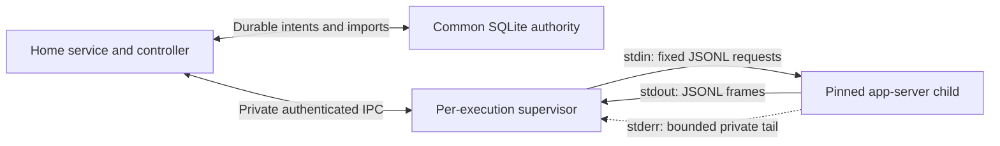

# Supervisor-owned primary stdio

Keelmux's experimental Codex control channel places the native connection in the per-execution supervisor. The home service keeps lifecycle authority and durable evidence; the supervisor keeps the child and its pipes. A daemon reconnect can inspect that original channel without creating a replacement or replaying a resume.

This is a **development architecture guide** for the host-internal `ExperimentalStdioPrimary` boundary. It adds no install command, public RPC, product launcher, semantic writer or approval flow. Published [v0.2.1](https://github.com/seanheiney/keelmux/releases/tag/v0.2.1) and its qualified terminal workflows remain unchanged. See the [support matrix](user/support-matrix.md) for released behavior.

## One owner for the native connection

Three independent pipes keep protocol frames and diagnostic output separate. The supervisor uses fixed native arguments and an explicit environment containing the selected HOME, CODEX_HOME, XDG directories, temporary directory, PATH and locale. It does not extend the parent's environment. These private directories establish a configuration scope; filesystem, network and credential confinement require separate evidence.

The channel binds the original host, session, execution generation, start operation, primary incarnation, native thread, realm revision, binary/schema digests and child lifetime. A separate channel incarnation identifies the pipe connection. A PID, workspace path or native timestamp alone cannot establish ownership. Existing PTY and ordinary process supervision remain distinct runtime paths.

## Intent, attempt, observation

The existing home lifecycle gate first validates the explicitly reserved native thread and workspace. Its immutable common-store start claim permits one new incarnation. The controller then records its private intent and attempt before launch. The helper retains its own launch and bootstrap attempts before effects.

The pinned Codex 0.159.0 codec emits only the reviewed bootstrap sequence: `initialize`, `initialized`, and exact `thread/resume`. Resume omits history/path and configuration overrides that could change the selected conversation. Bootstrap steps are recorded before bytes are written. A timeout, lost acknowledgement or interrupted sequence leaves an unknown outcome; reconnect does not resend it or finish abandoned steps.

Subsequent inspection uses fixed loaded-thread, thread, queue and background-terminal reads. Readiness requires an exact loaded thread and workspace, idle status, explicit empty/end-of-pagination evidence, intact receive continuity, current child/image/directory identity and no pending event. The codec accepts declared envelope details such as optional `jsonrpc` and notification timestamps without treating them as authority. The narrow evidence profile remains stricter than general protocol validity.

The [private contracts](../internal/primarystdio/contracts.go) and [pinned codec](../internal/primarystdio/codec.go) keep parsing, lifecycle effects and authority separate.

## Commit evidence before acknowledging it

The supervisor assigns every complete inbound frame a sequence and chained digest. Raw protocol bytes and stderr stay in private helper state. Common imports retain bounded frame metadata, exact channel identity and snapshot evidence. Reverse requests, malformed input, unsupported methods, unknown correlation and continuity gaps become blocking evidence. They are not native approvals and cannot be cleared by acknowledging an import.

The controller follows one order:

1. Observe a contiguous batch from the common store's committed cursor.
2. Validate its identity, bounds and chain, then commit the immutable import and updated anchor atomically in the existing SQLite store.
3. Check the returned import ID, channel, range and digest before acknowledging that evidence to the helper.

The reservation anchor names the entire retained chain. Missing channel, interior or tail records, changed canonical bytes, orphan records and a substituted empty cursor remain repair conditions. No scan of surviving rows can recreate a healthy prefix. Import failure produces no acknowledgement. A lost acknowledgement is reconciled using committed evidence and the known retained frontier; it never authorizes a native action.

Storage is finite. Shared bounds cap frames, exchanges, retained blocking evidence and stderr; the common journal also has lifetime import/event/byte limits. Exhaustion or persistence failure makes the channel unavailable rather than discarding a blocker and returning healthy.

## Two barriers protect the final effect

The home service's shared callback registration barrier and the helper's receive guard cover different races. The shared barrier orders already-announced broker callbacks with launch, bootstrap, publication and stop. Callback registration releases its short lock before waiting for home admission.

For publication, the helper holds a bounded receive-registration guard on the same authenticated IPC connection at the exact imported cursor and snapshot digest. Inside that guard, the common store rechecks its blockers and stop fence before publication; the journal records the result. The controller requires one bounded closure invocation and an observed guard result. Lost guard acknowledgement remains uncertainty even if a local commit succeeded.

For stop, the home first commits its original durable stop fence and the controller records its attempt. The helper checks the current receive frontier, then durably records its signal attempt before acting on its retained direct child handle. A callback arriving before that final check must block the signal or leave the operation uncertain. These barriers order cooperating control; they do not freeze future native activity or prevent an arbitrary same-user process from acting outside Keelmux.

## Recovery preserves the original attempt

| Boundary | Recovery behavior |
| --- | --- |
| Daemon IPC loss with a surviving helper | Authenticate the original channel, import its retained evidence, and obtain fresh guarded inspection. No new launch or bootstrap. |
| Lost bootstrap or import acknowledgement | Preserve the attempted operation and reconcile known replies/committed cursors. No native request replay. |
| Stop refused or acknowledgement lost | Keep the stop fence. Import retained late events without native reads, then inspect exact process death. No second signal. |
| Child exited | Retained-only evidence may be read from validated terminal receipts and private helper state. It cannot publish Ready. |
| Missing/corrupt journal, helper receipt or unknown child lifetime | Report uncertainty or repair. A saved PID is not replacement or signal authority. |

A matching stopped Start/Stop request remains a reconciliation of the original operation. It cannot reopen admission. Host reboot, native provider resume and execution movement remain separate recovery boundaries.

## Keep proof tags distinct

| Evidence | What it establishes |
| --- | --- |
| Stdio channel / `supervisor_stdio` | Supervisor-owned pipes, exact channel correlation and a guarded protocol cut when all required checks succeed. |
| Earlier WebSocket controller records | Their own socket/capability-token observations. Untagged old records cannot be adopted as stdio records, and stdio records cannot supply `SocketIdentity` or native bearer-auth proof. |
| Deterministic child or injected supervisor fixture | The exercised implementation boundary under that fixture. It does not establish actual Codex behavior. |
| Actual native qualification | Separate exact-source, native-binary/schema, environment, image, confinement and lifecycle evidence. It is still required. |

`ChannelVerified` describes the experimental channel result; `NativeProviderQualified` remains false. Normal Darwin stdio launch refuses before a helper or child effect because running-image verification is unavailable. Test-only image seams cannot enable the installed adapter. Linux image-verifier source is also separate from actual native acceptance. Product writer access, remote approvals, semantic delivery, effective account/model identity and confinement remain unqualified by this channel.

## Reusable capabilities remain provider-specific at the edge

The [capability library](architecture/0003-reusable-capability-library.md) supplies immutable packs, pinned profiles and individual skill/rule/tool switches. Its adapters preview and apply supported native configuration. The stdio controller supplies lifecycle ownership and evidence; it does not change a profile's permissions, load a tool automatically or make native loading equivalent to invocation.

The same portable pack can map to Codex, Claude, Gemini and OpenCode through each harness's supported configuration. Grok's reviewed mapping uses literal rules and an instruction index; MCP is unsupported by that installed contract. OpenRouter session selection currently goes through OpenCode's native provider setup. Neither route acquires Codex stdio capabilities. Optional Headroom declaration, health, loading and actual invocation remain separate observations.

Use the [reusable-capability guide](user/plugins.md) and [provider guide](user/providers.md) for their development workflows. Each harness needs its own protocol/lifecycle adapter and qualification before deeper control can be advertised.
