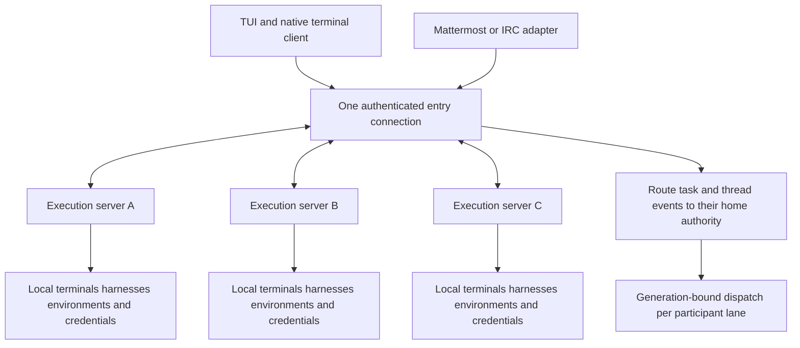

# Agent terminal backplane product vision and specification

Source: https://chatgpt.com/space/page_3c1ef53937d08191b084fe3e702ce9bb

Snapshot imported on 2026-10-10. This repository owns implementation decisions and evidence; the source Page remains the reviewed product brief.

Draft revised October 10, 2026. Architecture and commands are proposed product contracts; they are not claims of implemented capabilities.

A persistent, open-source bouncer for model CLI terminals: Herdr/tmux meets an IRC-style BNC, across a federation of user-owned execution servers. Each server runs actual terminals, native conversations, environments, and local login realms. One client connection gives a solo builder one permitted directory of agents, sessions, tasks, and threads across the federation.

Real model CLIs are the upstreams. The backplane keeps supported sessions reachable, routes communication, coordinates attention, manages skills/tools/resources, and repairs access. A task and its shared thread persist while a supported transition changes model, subscription, harness, or execution server. TUI/native terminals, Mattermost, and IRC are primary clients. Any future dedicated graphical client is a native desktop/mobile application; the product has no web-app interface.

The first public product serves solo power users and requires no product account. First use imports an existing working CLI setup and reaches one useful session quickly. Herdr is a terminal-backend candidate, selected only after comparative evidence; tmux remains a baseline. Team services, advanced orchestration, and richer clients follow the same simple core.

The first useful experience is small: install once, preload the connection skill into supported CLIs, reuse an existing model login, and invoke /backplane or the CLI's native equivalent. Attach or start a supported managed terminal, detach, and return. Add an existing SSH host with one reviewed join action, then use the same switcher and connection for its permitted sessions. Profiles, resource graphs, peer topology, subscriptions, and experiments are not onboarding forms.

The [first release build plan](https://chatgpt.com/space/page_f423896d21548191b10beb588787574f) defines the proposed implementation choices, command behavior, minimal TUI, and evidence required for terminal alpha, shared chat, and federation.

## Product vision and differentiation

Build the agent equivalent of an IRC bouncer. Upstream model CLI terminals and their native logins remain attached to user-owned execution hosts while downstream clients come and go. The bouncer owns durable identity, observed history, message routing, readiness, and attention. The selected terminal backend owns supported process and terminal lifetimes. Client disconnect does not end healthy work; reboot recovery is separately proven.

The daily loop is: connect once, find the right agent/session/thread, attach to the native terminal or send a clearly addressed message, switch away, and return to what changed or needs you. A thread remains reachable across the TUI and supported communication clients. The operator does not need a browser model interface or a new editor to use the system.

Four experiences must be excellent: instant orientation among many terminals and accounts; the same conversation across clients without duplicated prompts; one clear repair when login, quota, resources, or connectivity stop work; and continuing the task on another ready target without rebuilding its context. Adding servers expands where work runs and which permitted resources it can use while preserving this daily loop.

The bouncer analogy is the organizing architecture, rather than a commitment to embedding a particular IRC server. ZNC is an established IRC-bouncer reference; terminal multiplexers and provider protocols supply different parts of our execution path. Existing agent tools also offer parallel sessions and worktrees. Our differentiation hypothesis is the coherent terminal, login, communication, capability, and recovery layer across providers and independent machines. [ZNC official repository](https://github.com/znc/znc), [Zed Agent Panel](https://zed.dev/docs/ai/agent-panel), [GitHub Copilot agent sessions](https://docs.github.com/en/copilot/how-tos/github-copilot-app/agent-sessions)

Success means a solo builder can complete more useful, verified work with less attention and fewer setup failures. The ambition is a substantial improvement in daily capability. Originality, widespread adoption, and viral sharing must be established through use rather than asserted as product properties.

## Intended users and jobs

The first user runs several Claude Code, Codex, Grok, or similar sessions across multiple repositories. Some work happens on a laptop; long-running work belongs on a user-owned host that stays available. The user already has functioning agent accounts, tools, skills, and project conventions. Adoption should preserve that investment.

The product must make six jobs straightforward:

1. Find the session that needs attention and understand its request.

2. Switch between agents, live sessions, and saved conversations without losing place.

3. Keep work available after closing a client or losing a connection, and recover supported conversations after a restart.

4. Know which account, workspace, skills, tools, permissions, and resources each session actually uses.

5. Repair expired authentication, unavailable resources, and configuration drift with a clear next action.

6. Continue the same task and addressed shared thread across clients, models, authorized subscriptions, harnesses, and execution locations; see usage and capacity without confusing estimated usage with actual charges.

The product succeeds when the user spends less time locating, reorienting, configuring, and rescuing sessions. More sessions and more notifications are not success measures on their own.

Small-team leads, consultants managing several client accounts, and platform engineers are later audiences. Their needs inform identity and adapter boundaries without adding shared administration to the first release.

## Product commitments and scope

Every session exposes its task/shared thread, exact workspace and host, harness/version, requested and observed model, effective account where observable, subscription or API binding, and profile revision. Compact rows show only the useful target and next action; inspection holds the evidence. Unknown or inferred information remains qualified. A finished turn, an available process, and verified task completion are separate facts.

The user controls permissions, eligible accounts, resource bindings, and continuation policy. Keep bindings stable during ordinary operation. An explicit switch or a previously approved, bounded continuation policy may select another ready target. Repair never expands access or moves subscription work to billed API usage outside that authorization. Existing native user, repository, and organisation configuration remains authoritative in its tested precedence.

The user-owned bouncer, host connector, CLI, TUI, federation protocol, and core adapters are planned under Apache-2.0, subject to compatible component licenses. The initial workflow requires no product account, vendor relay, telemetry upload, or public listener. Optional diagnostics exclude prompts and credentials by default and require consent.

The launch center is federated terminal/session/account inventory; native attachment and fast switching; durable tasks and shared threads; supported prompt routing and continuation; attention; skills/tools/resources; grouped login repair; subscription capacity and truthful usage; and dependable detach/reconnect. Observation is the import default, with managed control explicit. Local use works alone; remote use reaches the authorized federation through one connection. TUI, Mattermost, and IRC share the same core.

Use three scope tiers. Core features improve connect, switch, communicate, continue, or recover, including one-connection federation, scoped resources/placement, capacity management, and supported model/account/harness handoffs before Personal 1.0. Natural extensions add reusable setups, richer movement, attention batching, and resource coordination. Optional experiments add journey review, bounded alternatives, correction fixtures, capability labs, development companions, and clustered authority. A feature must improve a core job without adding mandatory setup. A local session remains useful without peers.

## Optional development companions

An owned IDE-like environment remains a possible native client and future expansion. Operating model CLIs happens through native terminals and unified communication threads. There is no web-app client. Editor bridges can open exact files, diffs, and receipts in the user's current tools.

Develop a native review companion only when it demonstrably reduces a review or repair burden. Use platform-native interaction, accessibility, and secure local integration with the same scoped API. A code/diff viewer can precede editing; editing requires tested workspace conflicts. This optional client never delays the TUI/chat core.

| Client | Core role | Priority |
| --- | --- | --- |
| TUI and native terminal | Fast switching, native model use, thread communication, management, and repair. | First-class launch surface. |
| Mattermost and IRC | Continue addressed threads and resolve supported decisions in existing clients. | First communication clients. |
| Editor bridge | Open exact code, artifacts, and context in existing tools. | Optional extension. |
| Native desktop/mobile companion or owned IDE | Inspect results and later integrate development workflows. | Conditional native expansion; no web-app interface. |

The product center stays the persistent terminal and conversation layer:

```text
Model CLI + login + native thread
              |
      terminal backend / host
              |
   persistent agent bouncer
   threads · history · readiness · routing
              |
    TUI / IRC / Mattermost / future clients
```

Optional artifact clients retain the exact host, workspace, and checked revision. They cannot silently turn a result from another tree into evidence for the selected session. The terminal/chat core also opens these references through the user's existing editor or browser when requested.

If a preview client is added, isolate the application's content from control credentials and avoid publishing private services merely to inspect them. Browser context and account access require a supported binding. Verification uses an immutable snapshot or records changed inputs as unstable.

A full IDE distribution requires evidence that critical user workflows cannot be supported through stable bridges/components, plus a sustainable maintenance plan. It is a separate investment decision after the bouncer is useful on its own.

## Interface simplicity beauty and delight

Make management disappear into a simple daily loop. Start in the session switcher or last native terminal, scoped to the remembered company/product group. Sessions answers where to continue; Inbox answers what needs the human; Threads provides shared communication. A group captain and personal captain are optional contextual helpers. Library and Peers stay in the picker; no graph or organisation setup is required.

First use connects an existing installed/authenticated CLI and shows its actual account and workspace. New work can start from one sentence with a compact context line such as “Claude · work login · Studio · this worktree.” Reuse deliberate defaults and existing grants. Add fuller briefs, criteria, budgets, or profiles only when useful. Login, required dependency failures, and identity ambiguity open a focused repair.

Each row shows a useful name, provider, account alias, execution place, and plain next action: Attach, Sign in, Reconnect GitHub, Continue thread, or Inspect recovery. Preserve simultaneous requests under an accessible count. Lifecycle, credential realm, capability evidence, diagnostics, and resource scope unfold in inspection rather than becoming permanent columns.

Switching works through a universal picker, recent-item cycling, and visible contextual actions. It restores the file, selection, scroll position, draft, and supported terminal context. If content moved, disappeared, or cannot be recovered, restore the available anchor and explain the change. Switching or searching known records does not call a model. Background events update relevant counts without reordering the item under the pointer, opening panels, or stealing focus. A Leave and return action bookmarks the current view and event position; return opens a comparison against that bookmark. It records orientation without promising to stop every agent or roll back external activity.

Read-only discovery, safe readiness probes, incident deduplication, connection retries within the chosen policy, and restoration of interface place happen automatically. New accounts, resource grants, executable capability installations, broader permissions, paid modes, and remote exposure appear in one reviewable setup plan. Existing authorization is reused within its actual scope.

For the TUI, use a readable monospace grid, stable alignment, restrained accent colour, text states, and configurable density. Preserve native CLI keys outside the management prefix. Support plain/ASCII output, narrow terminals, visible selection, discoverable shortcuts, and tested screen-reader behavior. Chat replies are short with direct commands and detail on request. Any later dedicated graphical client follows platform-native accessibility, keyboard, appearance, and touch conventions.

Joy comes from immediate attachment, preserved place and drafts, reliable previous-session switching, quiet background work, and one repair for related failures. Avoid animation that delays a terminal action. Show observed phases rather than invented progress percentages. Put feedback beside the affected work and interrupt only when the decision warrants it. [Apple feedback guidance](https://developer.apple.com/design/human-interface-guidelines/feedback)

Empty, loading, unsupported, offline, wrong-account, quota, conflict, and recovery states need the same care as the happy path. Preserve drafts and history, say what is known, and give a concrete next step. Locally reversible interface changes can feel immediate. Consequential external actions show pending, confirmed, failed, or outcome uncertain; a lost acknowledgement opens reconciliation. Accepting a result never silently merges or publishes it.

Three pilot gates make the interface requirement testable: five of six independent users reach their first useful session within two minutes with a supported installed/authenticated CLI; median locate-and-open stays below five seconds among ten sessions and users identify the next action within ten further seconds; a shared repair takes at most three product actions excluding the vendor login and users distinguish recovered work from an uncertain mutation. Scripted background events cause zero focus steals, wrong-workspace dispatches, or lost drafts. These are proposed acceptance targets, not measured results.

## Core objects

| Object | Meaning |
| --- | --- |
| Harness adapter | Versioned integration with a vendor CLI or another agent runtime; declares native terminal and semantic controls independently. |
| Model/provider binding | Selected provider, model, authentication mode, and supported entitlement path; separate from the harness. |
| Agent profile | Reusable role/preferences, instructions, pinned skills/tools, permission settings, and eligible execution targets. |
| Project | Repository or body of work, with optional external issue-tracker links. |
| Project group | Named company, product, client, or personal collection of projects/session/thread references; optional company-to-product hierarchy, with per-user membership and remembered view state. |
| Captain assignment | An ordinary managed agent lane/profile assigned to watch a company/product group or all authorized personal sessions, with chosen model/account/harness/host, read scope, coordination grants, cursor and budget. |
| Workspace | Exact host, repository identity, path/worktree, branch, and environment; includes relevant dirty state. |
| Task and work packet | Stable work identity and its versioned brief, decisions, criteria, progress, artifacts, and unresolved items. No mandatory task board. |
| Communication thread | Stable shared conversation with one home authority, addressed participants, events, and client mappings. |
| Participant lane | One agent's stable role within a task/thread; parallel lanes may use separate worktrees and targets. |
| Participant binding | Verified human identity or agent lane's current native thread, epoch, account, host and controls. |
| Native thread | Harness/provider-native conversation and lineage; several may serve one participant lane over time. |
| Session | Named navigable context joining task/thread, lane, workspace, profile revision, and current target. |
| Execution epoch / run attempt | Generation-bound attempt/configuration for a lane: harness, model, account, subscription, host, and controls. A supported in-place model change can advance the epoch without replacing the process. |
| Process lifetime | Runtime/process identity, host boot generation, process-start evidence, and terminal backend references. Separate from logical execution epochs. |
| Account binding | Host-local credential realm reference, verified principal where available, expected identity, and observed auth state. |
| Subscription binding | Provider plan/entitlement linked to verified account scope, management metadata, quota observations, and billing mode. |
| Capacity pool and quota bucket | Eligible authorized targets plus routing policy; buckets preserve provider-native units, shared scope, limits, windows, and freshness. |
| Usage record | Deduplicated observed request/turn/metering event with actual model, epoch, account, harness, host, scope, and measurement quality. |
| Resource binding | Scoped tool, service, data source, dependency, or secret reference; credentials remain at its home. |
| Attention item | Actionable question, permission, review, recovery, or capacity request. |
| Artifact/evidence receipt | Inspectable result and relevant inputs, environment, check, and actual outcome. |
| Checkpoint/context bundle | Versioned recoverable workspace/context references and operation ledger, including provenance, omissions, and unknown outcomes. |
| Experiment/resource lease | Bounded alternatives or managed ownership of a supported resource; neither grants universal isolation. |
| Execution server | An instance/host running real terminals, harnesses, environments, credentials, and local resources. |
| Entry gateway | An authorized server accepting one client connection and routing access to owning servers. |
| Peer grant/capability advertisement | Scoped directional permission and expiring authorized inventory; discovery alone grants no access. |

Stable task, thread, session, and lane IDs outlive panes, native conversations, processes, and gateways. Use one managed writer and one transition controller per lane/native conversation, with generation-bound dispatch. Multiple lanes may work concurrently; changing one lane does not pause the entire task. Shared-file and resource conflicts need their own coordination.

Saved threads remain discoverable after a session stops. Forking creates explicit lineage. Switching providers or incompatible harness/account contexts normally creates a new linked native conversation under the same task and communication thread. A tested in-place model change or native resume may retain its native conversation; the support matrix decides.

## Unified agentic threads

A communication thread is the stable shared conversation across the TUI, Mattermost, IRC, future clients, and authorized peer instances. It belongs to one authoritative instance and links selected agent sessions, each with its own native conversation and login. The product thread is the shared communication record; it does not merge hidden provider context or transfer account permissions.

A participant alias stays stable while its lane's execution target changes. The binding identifies current epoch, harness, actual model, native thread, execution server, account/entitlement, and supported controls. The composer names the recipient and current target. Group messages reach only selected recipients or a configured routing rule. Replayed history and incoming replies do not wake every agent. A saved draft retains its recipient; show the new target before sending it to a replacement.

Each message carries a canonical ID, actor, recipients, thread ID, reply-to/causal parent, originating client/source IDs, content references, and intended action. The authority assigns per-thread event sequence numbers; there is no assumed global order across all federated threads. Preserve original timestamps while using the authority sequence for replay and reconciliation.

Delivery state records what is observed: received by the bouncer, durably queued, submitted, provider accepted or turn started where confirmable, response completed, failed, or outcome uncertain. Chat delivery and agent delivery are separate. Writing bytes to a PTY is not proof that a provider accepted a prompt. Stable operation IDs prevent repeat dispatch where the managed adapter supports it; a missing native acknowledgement requires reconciliation.

Structured prompts queue at supported turn boundaries. Terminal input has one managed writer; chat prompts cannot interleave with human typing or unfinished native input. Unsupported queuing becomes a clear wait/native-attachment action. Reconnect observes first, then explicitly reacquires control. Raw keystrokes are never replayed.

Distinguish structured replies, captured terminal observations, questions, permissions, and system incidents in the history. Capture only observable output under the configured retention/access policy. Full native scrollback, structured conversation history, and hidden reasoning have different availability. History gaps and inference stay labeled; read markers represent what a client actually saw.

Human identities are linked and verified per client. A model message saying “approved” has no human authority. Permission actions bind the exact native request, current run, action/scope, and deadline. Delayed messages and recalled history cannot authorize replacement requests. Source posts and local transcripts are untrusted content, not control commands.

Example flow: prompt api-codex in the TUI, detach, read its question in Mattermost, reply to that participant, then return through IRC or the native terminal. The canonical thread shows one message and its actual delivery state across clients. Drafts remain scoped to thread and recipient; no client echo creates another model turn.

A small command vocabulary is shared across clients: list, attach where supported, message, inspect, sign in, resume, interrupt, stop, and move. CLI/chat syntax can differ while targeting the same operation schema. Agent-to-agent collaboration is an explicit routed action with originating human scope, causal limits, budgets, and loop protection, rather than unrestricted terminal send-keys.

## Work packets and evidence

A work packet is a compact, versioned brief for one outcome. It contains the objective, linked issue or source request, acceptance criteria, selected context references, permitted resources, budgets, assigned sessions, resulting artifacts, unresolved questions, and the next human action. The user can create one from a prompt, issue, code selection, failing test, or browser observation.

Existing issue trackers remain the system of record where the project requires them. The packet records the execution brief and evidence, and links or synchronizes supported fields with that issue. It does not introduce a second mandatory task board. Simple sessions can begin with a minimal packet and acquire more structure only when useful.

Explicit acceptance criteria are versioned when supplied and revised when direction changes. A session can begin from an objective without a mandatory checklist. Suggested checks remain proposals until accepted. Show which sessions received each brief revision, which still use an earlier one, and which could not receive it. Deliver updates through supported queues or turn boundaries. A changed brief is not silently rewritten into an active agent's context.

Evidence receipts record what was actually observed: the repository commit and working-tree digest, command or check, environment/configuration references, outcome, timestamp, and artifact location. Include relevant dirty or untracked files rather than pretending the commit alone identifies the tested state. Reuse existing CI and test reports when their provenance matches.

Prefer an immutable verification snapshot when other agents or the human can edit concurrently. If the checked inputs change during verification, invalidate the receipt or record an unstable-state result. File hashes observed before a check do not prove the process consumed an unchanged tree. Distinguish unsaved editor buffers from the disk state being tested.

Separate agent claims, recorded observations, completed checks, and human acceptance. A passing test covers its stated assertion and environment. It does not prove deployment, an untested interaction, or complete task success. Later edits mark dependent evidence stale; a new verification run produces a new receipt. Validity follows relevant inputs and a check's declared lifetime; process death or age alone does not erase a historical result. Model agreement does not replace these checks.

A task's packet can link several native conversations. A cross-provider/harness continuation creates a new native conversation from an inspectable checkpoint while keeping the task and shared thread. Include selected context, verified artifacts, open questions, restrictions, and omitted/unavailable material. The manifest covers inputs we assemble; native instructions, retrieval, and compaction may remain unobservable. Destination credentials, resource grants, and native permissions are checked separately.

## The TUI experience

Start with one switcher scoped to a named company/product group or All work. Companies can collect products; products can collect several repositories/projects. Flat and standalone groups work equally well. Threads, Inbox, Library and Peers remain contextual capabilities within this same navigation:

| View | Purpose |
| --- | --- |
| Sessions | Default home: find and attach to terminals, launch or resume supported sessions, and inspect identity and readiness. |
| Threads | Contextual shared conversations, recipients, drafts, delivery state, and native-thread links. |
| Inbox | Contextual permissions, questions, review, account/resource recovery, and capacity decisions. |
| Library | Import and manage profiles, skills, tools, plugins, and dependencies through the picker or affected session. |
| Peers | Inspect local/remote places, federation grants, resources, and readiness through the picker or affected session. |

Accounts, subscription pools, usage, harnesses, servers, and resources open from the selected work or command picker. Show what is ready, what blocks continuation, and one next action. Full model/account/harness/host details appear in the selected row's context and target chooser rather than crowding every row.

Search session name, provider/model, account alias, company/product group, project, execution place, and native/shared thread. Search begins in the current group, including its visible child groups; explicitly select All work to search the authorized federation, including ungrouped work. Show attention here and a deduplicated global count, with separate next-needs-me-here and next-anywhere actions. A quiet group remains usable without hiding work that needs attention elsewhere.

### Company and product groups

A group is a working collection such as a company, product, client, or infrastructure area. A company can contain product groups, each with multiple projects; users can also create a flat group without that hierarchy. A group includes its permitted terminals, tasks, saved/shared threads and attention across servers, providers and harnesses. Project headings can collapse, while a compact active-group label and recent/favourite picker keep navigation quick.

Create groups by naming them and selecting existing projects, with optional individual session/thread pins. Reuse verified project mappings when new work links or launches; do not add a grouping form to every session. The same project/thread may appear in several collections through stable references. Membership never clones native conversations, changes execution targets, grants resource access, or broadcasts terminal input. Model, account, harness and host changes preserve membership.

Switch group, return to previous group, or enter a product from its company without losing place. Each group remembers selected project/terminal/thread, filter, expanded rows, available scroll/read anchors and supported terminal arrangement. Drafts remain keyed to the actual thread/recipient. Restore saved view state after reconnect; explain unavailable anchors and display remote work's truthful last state. Group switching leaves healthy agents running and uses no model call.

Groups and memberships are user-owned navigation metadata, distinct from shared task authority and resource permissions. Persist them across client reconnects; keep device-specific layout/view state local where appropriate. Archived groups retain history references, and removing a group never stops or deletes its sessions.

Illustrative layout:

```text
BACKPLANE · personal federation              1 here · 3 total
Company / product: Acme / Payments            g groups
Captain: Claude · work · studio               Advice
Project / work       Current target                    State
API
> Fix checkout       Codex · work · studio             Working
Website
  Review copy        Claude · personal · laptop        Needs reply

Fix checkout · thread #checkout · /work/api · managed
Enter attach   p message   r repair   Ctrl-P commands   ? help
```

Browse mode manages sessions and displays evidence. Drive mode attaches full-screen to the native agent terminal through a supported attachment path. The initial implementation delegates terminal rendering to the selected backend/native client. A new embedded terminal emulator is outside the first release.

Suggested navigation is configurable: Ctrl-P opens commands; slash searches the current scope; g opens the company/product group picker; arrows or j/k navigate; Enter attaches or opens an observed session's actual actions; p composes an addressed message; r repairs; n creates work. In managed Drive, the tested prefix Ctrl-G uses s for switcher, g for previous terminal, c for group picker, b for previous group, d for detach, and a doubled prefix for literal Ctrl-G. Group actions pass through the managed route; other native keys remain native. Validate collisions per CLI/terminal.

Remember place separately for each company/product group: selected session/thread, filter, expanded projects, available terminal/scroll/read context and recent history. Preserve per-thread/recipient drafts across groups and target changes. Events update scoped/global counts without moving selection or stealing input. Return shows what changed and the next action; stale anchors receive an explanation. Navigation and searching known records require no model call.

Interrupt, stop, and restart show their target and supported effect. Restart creates a new run attempt and reconciles any interrupted operation before retry. Archiving changes discovery and visibility; stopping changes the process; deleting history is a separate explicit action. An archive operation reports whether the session is still running.

Multiple clients may observe. One managed client holds the terminal input lease, and only that controller changes terminal dimensions. Takeover is explicit and audited. A reconnect restores observation before reacquiring control. Uncertain raw keystrokes are never replayed automatically. Structured prompts are queued or refused while another action owns input, rather than merged into a human's typing.

Direct native attachments outside the managed route have a visible enforcement boundary. Host owners can use their own sockets and terminals; the product must not claim universal exclusion from those routes.

## Group and personal captains

Assign a chosen model as captain of a company/product group, and optionally one personal captain across all authorized sessions in the federation. Each captain is a real managed agent lane with its own durable thread, model, account/subscription, harness, server, profile and budget. The daemon supplies events and scoped tools; captain reasoning remains model execution with visible usage. Captains are optional and never replace the switcher or vendor terminals. Assignment preflight verifies scoped event/read tools and a supported prompt path; unsupported watching is a visible repair or manual mode.

Assign captain from the group or command picker, choose a ready model/target, and review its scope and limits in one compact flow. Default to Observe and advise: summarize progress, blockers, unanswered questions, review needs, quota/auth/resource incidents, possible stalls, duplicate investigations and workspace conflicts from available evidence. Reports link affected sessions and distinguish agent claims, observed state and verified results. Unknown or stale coverage is explicit.

The personal captain combines authorized group reports with uncovered/ungrouped sessions, deduplicates overlapping groups and prioritizes what needs the human. It can answer What needs me?, What changed?, and Where can this continue? through its same TUI/chat thread. Group reports include source references, freshness and coverage; reading a summary never grants its underlying private data. Notification policy coalesces related incidents and keeps unchanged work quiet.

An optional Coordinate within limits mode grants named structured actions such as messaging/delegation or requesting a supported continuation, restricted by project/resource scope, target generations and budgets. Group membership itself grants no authority. Human instructions and native permissions retain precedence; captain output cannot approve a human-only request or inject raw keystrokes. Conflicting captain instructions become a visible decision; coordination binds the originating request, target lane/epoch and action revision. The owner accepts at most one managed response for that request/revision, then uses its durable outbox for delivery.

Wake captains on meaningful journal changes or a configured digest cadence, coalescing events with bounded latency. Idle observation is daemon work with zero model turns during an unchanged period. Persist consumed event IDs/cursors, reports and proposed-operation identities; commit each report and cursor together, with action delivery through the outbox. Captain reports/actions do not recursively wake themselves or other captains outside a bounded, directed reporting rule.

Resolve group membership and grants on every read/action, update coverage after moved sessions or revoked access, and treat native output/tool results as untrusted data. Keep captain reports within their input visibility scope. Reuse the existing prompt/outbox, per-lane input ownership and continuity coordinator; a captain may change model/account/host only through the same verified transition contract as other agents.

Show current captain, actual target, Observe/Coordinate mode, last observation, freshness, suggestions and usage contextually. Read captain, Ask captain and Pause captain are direct actions. Pause stops new captain turns/coordination at a supported boundary while worker sessions continue; existing effects retain their actual outcomes. Captain consumption appears separately and within subscription/model totals, with visible quiet settings and budgets.

## Feature catalogue

The catalogue extends the bouncer's center. Core capabilities ship first: company/product grouping, fast switching, optional group/personal captains, addressed unified threads, account/resource readiness, grouped repair, imported skills/tools, history, and reconnect. Federated placement and movement extend that loop. The following experiments are optional and never prerequisites for operating the CLIs.

| Feature | Moment and interaction | Result and important boundary |
| --- | --- | --- |
| Since you left | Return to a project and see changes, new checks, questions, and interrupted operations since the last visit. | Restore orientation without rereading transcripts. Every statement links to an event or artifact; generated interpretation is labeled. |
| Point and repair | Select a failing test, code range, browser element, or console error and prepare a repair packet with reproduction and acceptance checks. | A grounded request with the right workspace and evidence. Preview selected data before transmission; include only the supported browser/context scope. |
| Readiness plan | Resolve a chosen work packet against a profile, workspace, accounts, tools, skills, and required resources; preview missing prerequisites and repairs. | Start with the intended capabilities. The plan explains native precedence and unknown state; it never grants access or pays for a new mode silently. |
| One repair for related sessions | Open one incident showing dependent sessions; renew the shared login or repair the service and recheck affected bindings. | Reduce repeated recovery work. Credential renewal follows host-local realms; quota follows verified account identity across hosts. |
| Journey and evidence review | Replay an approved user journey across baseline and changed builds; inspect changed moments beside the diff, checks, and unresolved questions. | Decide on the actual experience. Matched runs require appropriate test identities/data; recorded comparisons remain labeled. Human acceptance, merge, and deployment are distinct. |
| Try two approaches | Start two bounded alternatives from the same brief and baseline; compare previews, diffs, tests, elapsed time, and measured usage. | Choose with artifacts rather than persuasive prose. Estimate expense first; do not silently merge, replay writes, or label shared-user worktrees as sandboxes. |
| Checkpoint and branch | Record recoverable files, context, profile references, and operation receipts; create a new attempt from an available checkpoint. | Explore or rescue a local workflow. Report missing state; external actions and hidden model state are not automatically reversible. |
| Change agent and continue | Inspect a handoff bundle and launch a fresh native thread on another selected provider. | Preserve the work brief and available context. Native conversation state is not converted, and account or spend changes require an explicit choice. |
| Shared resource coordination | Allocate supported ports, test services, temporary databases, and integration branches; show conflicts and ownership before dispatch. | Avoid ordinary contention. Enforce leases only on managed paths and use OS isolation for stronger containment. |
| Focus mode | Set a focus period and attention rules; batch routine results while exposing unresolved decisions according to the user's policy. | Quiet work with a clear return view. Expiring permissions retain their native behavior; focus mode never answers them automatically. |
| Project knowledge | Save useful decisions, architecture facts, and verified recipes with source references and a review history. | Reuse context across sessions. Mark records stale when source references change; control project scope, deletion, and which records enter a prompt. |
| Skill and tool lab | Compare pinned profiles or capability revisions on a small repeatable fixture using the user's selected providers. | Improve the setup using measured outcomes. Record versions, environment, cost, and trial variation; one successful run is not a general reliability claim. |
| Reusable capability kits | Export a profile, dependency declarations, optional verification fixture, and reusable recipe; import with a configuration diff and local binding steps. | Share a useful working setup. Exclude credentials/private context, pin provenance, require trust, and report provider-specific mappings. |
| Shareable result capsule | Select a before/after preview, diff references, acceptance criteria, and evidence receipts; inspect the exact export. | Ask for review or demonstrate a result. Sharing is voluntary, scoped, and redacted; links do not convey the sender's resource access. |
| Compare and repair setup | Compare an affected session with a working reference; preview the smallest configuration, dependency, or binding repair. | Explain why this setup differs. Preserve target identity and scope; never copy secrets or assume the reference setup is universally correct. |
| Correction to regression | Select a useful human correction and propose a scoped rule, recipe, or characterization test that fails before the fix and passes after. | Make the next attempt better through a verified fixture. Promotion is explicit; preferences and defects need different checks, and one example does not prove generalization. |
| Short decision session | Choose a time budget and review the human decisions with the largest observed impact, stated deadlines, and project priority. | Spend attention deliberately. Explain the ranking; group related incidents without bulk-approving unrelated requests or inventing answer-time estimates. |
| Counterexample and recovery rehearsal | Ask a bounded reviewer to challenge a completion criterion or exercise a named failure in a disposable supported environment. | Find concrete gaps and practice repair. Tests use approved targets and limits; no production fault injection or universal containment claim follows from one rehearsal. |

Readiness planning should begin as deterministic dependency resolution and diagnostics. AI can propose resource requirements or explain a failure, but proposals remain separate from observed state, grants, and executable repairs. A user should be able to ask why a capability is available and see its source configuration, native scope, bindings, profile revision, and observed usage.

The alternatives feature starts with human-selected agents and a shared budget. Enforce managed queue and concurrency bounds; treat spending thresholds as advisory/cooperative unless the exact provider transport proves a hard cap. Cancellation can arrive after further usage. Common criteria and controlled baselines make comparisons useful; identical prompts do not make provider behavior identical. A reviewer can challenge both alternatives, and an independent test runner can collect comparable receipts. Integration uses an explicit selected branch and current-base checks.

Managed resource coordination covers logical ownership and supported allocators. Worktree separation alone cannot stop an agent using another port, database, credential, or shared file. Show advisory collisions when enforcement is unavailable. A change that conflicts with an unknown external writer requires reconciliation.

Project knowledge has inspectable sources and retention. A repository change can invalidate a prior conclusion without deleting its historical record. Suggested memories and recipes need an explicit promotion step; noisy transcripts do not become permanent instructions by default. Context selection shows what will be sent to which provider and reports material omissions.

## Signature workflows and demonstrations

### Switch clients without losing the conversation

The operator discovers two real model CLI sessions with different account bindings, attaches in the TUI, and sends a clearly addressed prompt. The operator detaches and opens the same communication thread in Mattermost or IRC. History is replayed once, the pending question is visible, and the operator replies to its explicit recipient.

Return to the TUI and attach to the original native conversation. The bouncer shows what was delivered, what the provider confirmed, and what remains queued or uncertain. No chat echo creates a second prompt. The model login, workspace, and native permission behavior remain identifiable throughout.

Demonstrate this on real supported CLIs and clients. An install-to-first-session clip should show the short setup path. A separate recorded clip can show longer-running work with actual timestamps; fabricated completion or acknowledgement is never used to fit a duration.

### Recover several sessions through one repair

Several sessions depend on one expired tool or model login. The shared thread/inbox shows one repair and its affected sessions. The operator completes the official login once through the relevant native/browser flow; the bouncer verifies identity and access, then checks each affected binding.

The demonstration ends with eligible sessions continuing and an interrupted external write waiting for reconciliation. The memorable experience is the reduction in repeated operator work, backed by actual recovery evidence.

### Share a working capability

A builder exports a useful profile and recipe with a small verification fixture. A second machine imports it, previews configuration changes, reports an unsupported mapping, and binds its own accounts/resources. The fixture runs and produces a local result receipt.

The recipient receives useful expertise without inheriting another person's credentials. Measure successful recipient use, subsequent reuse, and voluntary sharing; downloads or public screenshots alone do not establish this loop.

Another demonstration connects a second independent instance, grants one project/resource, launches on its host, then moves supported work through a recoverable checkpoint. Show the destination login and prerequisites, and recover an interrupted transfer. Optional result-review demonstrations follow the terminal, communication, and federation loops.

## Profiles skills and tools

The Library first imports a working setup. A user can select a common base profile, project-specific bindings, and a role such as implementer or reviewer. The resolved profile is versioned and recorded when a run starts.

Multiple logins to the same provider use documented native profile/configuration mechanisms or a tested isolated credential realm. If a CLI shares a global store, do not promise independent accounts merely by assigning aliases. Report whether simultaneous accounts require separate OS users or another supported environment. Account aliases are nonsecret labels; native login and refresh remain local.

Profiles describe instructions, skill sources/pins, plugins, MCP servers, hooks, binary requirements, model/harness preferences, eligible account pools, permissions, and resources. Harness/provider adapters map these to supported native configuration and report unmapped fields. A continuation preflight checks installed/discovered/loaded skills and effective tools at the destination; transferring a declaration does not prove it loaded. Preserve native precedence and unrelated user configuration.

Each capability has distinct evidence states:

| State | What it establishes |
| --- | --- |
| Desired | The selected profile requests this capability. |
| Installed | Its files, package, or configuration are present. |
| Loaded | The current process reports loading it, or the state is explicitly unknown. |
| Available | The provider exposes it and required authentication, scope, and health checks pass. |
| Observed | This run has actually invoked it, when usage is observable. |

The user can inspect provenance, enable or disable capabilities, pin revisions, preview updates, test connections, explain a missing dependency, and roll back managed changes. Required skills can prevent a managed launch when absent; installation alone does not prove the model followed their instructions.

Updates create a new profile revision. Preserve the recorded launch snapshot and materialize immutable managed assets per revision or run where feasible. Native agents may reread mutable configuration or skill paths, and external tool servers may change during a run. A pinned manifest therefore does not freeze the live environment. Track observed drift and supported reload/relaunch behavior; display sessions as current, drifting, waiting for reload, or unknown. Removal or emergency revocation reports its actual effective state rather than assuming a running process immediately forgets a capability.

Configuration application uses ownership-aware patches, conflict checks, backups, and recoverable writes. Preserve unowned configuration and native scope precedence. A rollout is planned and verified per host/provider; partial application across machines is reported honestly. Permission increases and account changes are visible in the preview.

Tack already provides pinned skill/plugin sources, deployment, audits, and a TUI. Evaluate it behind a narrow integration contract before rebuilding those functions. Profiles, live-session snapshots, and resource readiness remain product responsibilities. [Tack project documentation](https://github.com/chocs-cat/tack)

## Preloaded skills and one-command session linking

Install the Backplane connection skill and common selected skills across the user's supported CLIs once. Then link from inside the model CLI with /backplane, or the provider's native equivalent. This is the primary enrollment experience: a short in-session action analogous to the convenience of Claude's /rc, connected to our own terminal/communication backplane.

The installer discovers supported providers and user scopes, previews owned files/configuration and any command-name collision, and preserves existing skills, plugins, hooks, and native precedence. A shared source/pin maps to each provider's supported layout. New hosts or newly installed CLIs can receive the selected kit through an explicit enroll/apply operation. Existing native login tokens are not copied.

“Preloaded” distinguishes installed/discoverable skills from full instructions actually loaded into a model's context. Install the selected reusable kit broadly; load a minimal connection instruction or chosen startup brief through supported provider mechanisms. Required task skills can be included in a managed launch where supported. Do not inflate every conversation with the full catalogue, or call installed files proof that a model followed them. Show reload/restart needs and loaded/unknown evidence in inspection.

| CLI | Current documented invocation | Product integration target |
| --- | --- | --- |
| Claude Code | User-invocable skills appear as /skill-name; /rc links its native Remote Control. | /backplane skill backed by the local helper/adapter. Preserve the native /rc command and its separate service. |
| Grok Build | User-invocable skills and command files appear in the slash menu, with qualified names on collisions. | /backplane through a provider-scoped skill/command. |
| Codex CLI | Explicit skills use /skills or a $skill-name mention. | $backplane or /skills selection initially; literal /backplane only after a supported native command mechanism is proven. |
| Other CLIs | Adapter/version-specific commands, plugins, or extension hooks. | Closest native invocation; bp link is the proposed shell fallback. |

These are integration targets, not commands implemented by this product yet. [Claude skills](https://code.claude.com/docs/en/skills), [Claude Remote Control](https://code.claude.com/docs/en/remote-control), [Grok skills](https://github.com/xai-org/grok-build/blob/main/crates/codegen/xai-grok-pager/docs/user-guide/08-skills.md), [Official OpenAI documentation for skills](https://learn.chatgpt.com/docs/build-skills)

The skill calls a narrow local helper or scoped MCP operation. Trusted adapter/runtime metadata establishes host, workspace, current native thread/run, and account evidence; model-supplied IDs are not proof of identity. Reuse approved instance enrollment and grants. On first use, preview the selected instance, session scope, and downstream sharing. Ambiguity opens a small selector; it never guesses another terminal or account.

A native skill invocation may involve the model and its tool permissions; it is not guaranteed to be an immediate command transport. The deterministic helper validates a small command grammar, enforces identity and scope, and supplies the authoritative connection receipt. Use a direct native extension only where its supported mechanism is established.

Linking is idempotent for the same native conversation/run and instance. Repeating the command shows status rather than duplicating the thread, hooks, or prompt. Return a stable session/thread reference and the actual mode: managed terminal, supported provider bridge, or observation only. Registering an existing CLI process cannot retroactively give the bouncer ownership of its PTY or invent prompt/approval controls. Offer supported managed launch/resume when stronger persistence or attachment requires it.

The desired command family is /backplane, /backplane status, /backplane off, and optional thread/instance selection, mapped to each CLI's real invocation syntax. Status names the current instance, session, thread, provider/login, execution place, readiness, and available controls. Linking does not restart the conversation, switch accounts, or broaden permissions silently. Off disconnects the link/sharing according to its declared scope; stop, archive, and delete remain separate actions.

Acceptance: preload into clean and existing setups without overwriting native configuration; invoke from a real session and verify its exact identity; repeat without duplicates; reject ambiguous/stale context; reconnect after client/instance restart; preserve native input; and remove only owned installation/link state. Test each CLI/version separately and publish any manual step.

## Connecting required resources

A session needs more than an authenticated model. Resource bindings describe the exact repository/worktree, local runtimes and packages, MCP services, data sources, browser context where supported, cloud/project identifiers, network routes, and secret references necessary for its work.

Every binding declares required or optional status, expected identity, permitted scope, configuration/source revision where relevant, health evidence, and a repair action. Select resources from the user's existing inventory or an explicit setup flow. Suggested resources are proposals until the user grants the binding; discovery does not grant access.

For example, a release-review profile might require the correct worktree, release-review skill v3, repository-read access through GitHub, and the test runtime. A browser preview and design-reference connector can be optional. A missing optional preview does not stop unrelated review work.

Before a managed launch or resume, check the workspace, required capabilities, effective credentials, permission scope, and relevant host capacity. Safe probes use documented read-only operations. Any paid validation or state-changing setup is explicit. During execution, recheck affected dependencies after errors, configuration changes, identity changes, or reconnects.

One session inspector explains readiness:

```text
API refactor · server-1 · reviewer@7

Model account       Ready
Workspace           Ready
Required skills     Loaded
GitHub tools        Login expired
Test environment    Ready

Blocked requirement: GitHub repository access
Reconnect GitHub · Inspect connection · Attach
```

An unavailable mandatory dependency blocks new managed dispatch that requires it. Already-running or observed work is handled according to supported pause/control behavior. The product never labels an observed session fully governed merely because it discovered a hook.

## Authentication expiry and recovery

Authentication belongs to an account or resource credential realm, which can be shared by several sessions. Group repair by provider/resource, host, and effective credential realm. Show one workflow with its impact list: renew the work login affecting six sessions, rather than opening six independent login requests. Aggregate capacity by verified provider account identity across hosts; renew credentials by their host-local realm. Unverified identity associations remain separate.

Keep these failure classes separate:

| Failure | Required behavior |
| --- | --- |
| Client authentication or connection | Repair the client connection without restarting healthy agent work. |
| Vendor login expired or revoked | Attempt supported native refresh, then guide a human login when necessary. |
| Tool/resource authentication | Repair the affected connection and retain unrelated model/tool access. |
| Insufficient scope or wrong identity | Show the missing grant or account mismatch; do not treat it as a transient login error. |
| Quota exhausted | Show the observed account limit and reset time when available; follow an explicit waiting policy. |
| Process or host unavailable | Recover the supported run and workspace, keeping conversation identity separate. |
| Environment lifetime exhausted | Restore supported workspace data or offer an explicit new environment with a handoff. |
| Conversation no longer resumable | Preserve the product history and offer a clearly labeled new conversation with available context. |

The lifecycle is detect, classify, identify affected sessions, attempt supported refresh, request one human sign-in if needed, verify identity and access, recheck dependencies, reconcile interrupted operations, and resume eligible work.

Native clients own vendor login and refresh credentials. The backplane keeps host-local references and nonsecret status, not a central copy of vendor OAuth tokens. External resource credentials use an approved host-local store or secret-manager reference. Do not forward one resource's credential to another.

Codex's managed authentication owns its OAuth refresh and exposes account, capacity, and MCP-login controls. Claude documents login-expiry warnings and native renewal. Adapter support follows the actual authentication mode, not an assumption based on the presence of a credential file. [Official OpenAI app-server documentation](https://learn.chatgpt.com/docs/app-server), [Claude authentication documentation](https://code.claude.com/docs/en/authentication)

Expiry warnings appear only when reliable expiry metadata exists. Otherwise show last successful verification, current failure, and evidence freshness. Distinguish network errors, invalid credentials, access denial, quota, and missing model entitlement. Never silently route to another account or a paid authentication mode.

The TUI or phone starts an official device-code/browser flow where supported. Native terminal continuation remains available for providers that require it. Login links and one-time codes stay restricted to the linked human; token-bearing output is masked from routine logs and chat. Completion is followed by checks of the effective identity, organisation, scopes, and affected resources. If the intended identity or scope cannot be established, sensitive managed dispatch remains paused. Show the uncertainty and offer an explicit informed continuation or native attachment; never silently bind an unverified replacement account.

Reauthentication repairs identity. It does not establish whether an interrupted write already happened. Before retrying publish, push, PR creation, or another mutation, inspect the outcome or use a demonstrated idempotency mechanism. An uncertain result becomes a reconciliation item.

## Subscription pools and management

A pool is a set of authorized account/entitlement bindings and a selection policy. It makes usable capacity easy to find across servers and harnesses; it does not merge subscriptions into unlimited quota or share credentials. Several host-local realms can refer to the same verified account, subscription, or organisation quota bucket. User aliases alone cannot establish that relationship.

Track provider, principal/owner, plan, entitlement, active/paused/cancelled state, billing cadence/currency, recurring commitment, renewal, management link, and source/freshness. Mark fields provider-verified, user-entered, or unknown. Let the user inspect plans, pause a target's pool eligibility, choose preferences/limits, and open the provider's supported management or native sign-in flow. Direct renewal/cancellation/purchase controls require their own supported integration and explicit action.

Quota observations keep their native scope, unit, model/tool dimensions, window, reset, and source. Deduplicate a shared account/organisation bucket across hosts and harnesses. Show native remaining capacity and freshness; do not add incompatible percentages or invent a federation-wide remaining-token balance. One pool authority coordinates reservations for managed dispatch. Reservations cannot enforce provider-wide consumption by unrelated clients; stale observations and external usage remain visible.

Prefer the current target, then ready authorized alternatives that satisfy model capabilities, workspace/resources, identity, context, and spending policy. A quota failure can offer Continue elsewhere; renewing the same account can repair several affected lanes once. Wrong identity, stale capacity, unavailable isolation, or a changed billing mode blocks the automatic path. A global active-account toggle must never alter unrelated sessions: use a tested isolated runtime/realm or a supported relaunch.

Provider meters have different scopes. Codex subscription allowances and API billing are separate; Claude's local session cost/usage estimates are not a Pro/Max invoice and may omit other-device usage. Capture each source and coverage rather than treating a CLI display as a complete billing ledger. [Codex usage and pricing](https://learn.chatgpt.com/docs/pricing), [Claude Code cost and usage documentation](https://code.claude.com/docs/en/costs)

## Usage and model totals

Give one contextual Usage view for a chosen period/timezone, with filters for federation, server, project/task, harness, provider, account/subscription, and actual model. Answer: what ran, how much was measured, what remains ready, and what it cost. Show measurement coverage and excluded/unknown sources beside totals. Usage aggregation should work without transcript access; account labels and detailed costs have their own visibility scope.

Store canonical metering records per provider request/attempt where observable, linking logical user request, native turn, parent/retry/subagent, execution epoch, actual and requested model, account/entitlement, harness/version, host, time, and source quality. Streams, transcripts, cumulative snapshots, and peer replicas enrich that record rather than being summed again. When no stable native request ID exists, document the adapter's attribution limits and reconcile overlapping sources.

Keep logical requests, native turns, provider calls, retries, subagent calls, tool calls, and successful/failed attempts distinct. Total model counts means discovered/available models, distinct actual models used, active sessions by model, and requests/turns/tokens by actual model. Requested aliases and unknown actual models remain separate. One task that calls model A, retries A, and invokes child model B is one logical request, three observed provider calls, one retry, one child call, and two actual models used.

Preserve provider-native token semantics for input, output, cache, and other dimensions; included cache/reasoning tokens must not be counted again. Separate recurring subscription commitment, actual invoiced/API charges, credits/top-ups, local estimates, and token-equivalent value. Included subscription usage is not additional billed spend. Label monthly equivalents of annual commitments, retain currency, and do not silently combine currencies or unknown values.

## Continue the task across execution changes

The backplane owns the durable task, shared thread, visible journal, checkpoints, and action outbox. Harnesses provide replaceable execution and retain their native records. This is the portability boundary: use a supported in-place change or native resume when available; otherwise start a linked native conversation with explicit context. Preserve task title, participant alias, history, artifacts, corrections, read position, and drafts through the transition. Hidden reasoning, provider caches, account access, and native approvals do not transfer with the checkpoint.

Use an append-only visible-event journal and a versioned, checksummed checkpoint manifest. A checkpoint contains the objective, human corrections/constraints, decisions, unresolved questions, relevant visible history and complete tool-call/result pairs, operation outcomes, pinned profile/skills/tool declarations, environment/resource requirements, artifacts, and workspace revision plus dirty/untracked references. Retain source provenance and declared gaps/omissions. A compact summary helps context preparation; it cannot establish that a tool ran or an approval was granted.

| Transition | Preferred path |
| --- | --- |
| Model change in the current harness | Supported next-turn change; verify actual model and advance the execution epoch even if native thread/process survives. |
| Another subscription/account | Tested isolated binding or destination runtime; recheck identity/entitlement and native resume support. |
| Another harness/provider | New linked native conversation with compatible context/tool mapping and fresh permissions. |
| Another server | Verified source boundary, workspace/context transfer or shared-workspace proof, then destination-local bindings. |
| Source still active or effect unknown | Reconcile or enforce a real fence before replacement; connection loss alone permits no duplicate writer. |

The continuation coordinator is a durable operation per lane, using compare-and-swap on its ownership generation. Freeze new source dispatch and reconcile queued prompts. Reach a supported idle/checkpoint boundary or prove cancellation/quiescence; a generation token alone cannot stop a native CLI's file or network writes. Record completed, failed, and unknown effects without blindly replaying the turn. Persist the checkpoint and transition identity before preparing the destination.

Prepare the target without allowing execution. Check actual model/account/entitlement, isolated realm, context/tool compatibility, workspace state, resources/grants, quota freshness, and cost limits. Commit the new epoch only after readiness, then activate through a deduplicated generation-bound operation. Reconcile an uncertain activation acknowledgement before attempting another start. Invalidate old approvals and delayed commands. A paused source cannot resume after replacement; rollback first quiesces/reconciles the destination and creates another epoch.

Default UI: Sign in, Continue elsewhere, or Attach terminal. Continue elsewhere lists configured ready targets and previews material changes in model, account, harness, server, carried context, and missing resources. Ordinary supported changes take one selection and one short review, preserving the same timeline with a transition marker. An optional Keep going within my limits policy preauthorizes specific targets, grants, and spend caps at supported boundaries. Unknown writes, possibly active sources, identity uncertainty, critical context gaps, or incompatible grants require the focused missing action.

Automatic continuation assigns the next safe logical step. It never means replaying an entire agent turn through a generic retry router. Fault tests must prove crash/acknowledgement boundaries, queued input, incomplete tool pairs, workspace drift, expired realms, stale approvals, and partitions before describing a transition as seamless.

## Persistence and recovery guarantees

Publish a separate guarantee for each lifecycle event:

| Event | Product contract |
| --- | --- |
| Client detach or network loss | Work continues while its host and runtime remain available; the client returns to the same work context. |
| Backplane restart | Durable records and queued action identities return; surviving host work reconciles with the registry. |
| Agent/runtime restart | A new attempt may resume a supported native conversation; original process state is not assumed preserved. |
| Host reboot | Supported conversations recover unattended only where the release gate proves it; interrupted operations remain explicit. |
| Host sleep or loss | Sessions become unreachable with their last confirmed state; they do not silently migrate. |
| Workspace/environment loss | Recovery follows available checkpoints and artifacts; missing data remains visible. |

Persist native thread references, workspace/account bindings, profile revisions, action identities, and recovery evidence. Pending approvals from replaced runs become stale. Do not automatically resend an interrupted prompt or claim that a restored layout means the agent resumed.

Herdr documents live persistence after detach, snapshot reconstruction after restart, and eligible conversation restoration after a client supplies terminal context. Therefore its unattended reboot behavior must be demonstrated or addressed before adoption for that promise. [Herdr session state and restore](https://herdr.dev/docs/session-state/)

Recovered state distinguishes conversation loaded, resources ready, process running, turn continued, and task verified. A failed native resume retains its history and explains the supported repair or handoff path.

## Federation mesh and clusters

The system is a federation of execution servers that run the actual terminals, native threads, harnesses, environments, and local resources. Each server can remain independently useful. A remote client establishes one connection to an authorized entry gateway and receives one permitted directory of work and attention across reachable servers. The gateway routes messages, controls, and native terminal streams to their owners; clients do not configure a separate connection for every session.

A personal federation may enroll several owner-managed servers; an independent peer retains its own authority, policy, credentials, and history. The local installation can combine bouncer, gateway, and execution server. Join previews verified host identity and selected inventory/projects/resources/control scope. Peer grants remain directional; membership never imports another person's transitive permissions. Owners revalidate every operation against the original caller, audience, target, current grant, and ownership generation.

Globally identify tasks, threads, sessions, and resources by origin plus stable object ID. Task home authority, execution server, entry gateway, and client location are separate. Filter names and metadata before returning inventory. Advertisements carry capabilities/versions, placement constraints, scoped capacity, generation, observation time, and expiry; fresh target checks precede dispatch. The shared directory can show stale unreachable records without claiming they are ready.

Keep SQLite local to each service and exchange scoped events over authenticated APIs. Each task/shared thread has one home authority and event order; each lane has its own writer/transition generation. An entry gateway caches permitted views and routes authoritative writes to the owner. It can expose one viewer-scoped opaque reconnect cursor backed by upstream cursors, deduplicating replay without inventing a federation-wide total order. Revalidate cached access after revocation. [SQLite network guidance](https://www.sqlite.org/useovernet.html)

Credentials stay at their resource's home. A permitted remote tool operation uses short-lived scoped delegation naming caller, work/project, resource, audience, operation, and limits. The receiving instance checks its own grants and invokes its local binding. Direct MCP access needs authorization issued for that resource; tokens from another service are not forwarded. A remote resource and the agent's own model login remain distinct bindings. [MCP authorization specification](https://modelcontextprotocol.io/specification/2026-07-28/basic/authorization)

The destination chooser shows friendly place, readiness, relevant hardware/resources, effective account, workspace, and the next repair. Recommendations explain workspace locality, required hardware, or existing user preference. They do not silently change account, billing mode, or access. Skills/tool declarations can travel as pinned setup references; accounts and secret references bind locally.

| Operation | Actual behavior |
| --- | --- |
| Attach from another instance | Change observing/controlling client; the process stays on its execution node. |
| Run new work elsewhere | Start a new authorized attempt on a ready destination with its local login/resources. |
| Use a peer resource | Invoke a permitted remote operation without exporting its credentials. |
| Move work | Quiesce the source, reconcile interrupted effects, transfer permitted workspace/context checkpoint, check the destination, and start a new attempt. |
| Resume a native conversation on another machine | Offer only for tested provider export/import/history combinations. |
| Continue through another provider | Create a linked new native thread from an inspected handoff bundle. |
| Migrate a live process | Separate platform-specific execution support with its own proof; never implied by a saved terminal layout. |

Movement preserves recoverable source files/history until destination verification and fences the affected lane, leaving unrelated lanes available. Initially task authority stays home even when execution moves. Authority transfer is a separate durable operation. Missing acknowledgements require reconciliation. Connecting through another gateway changes the access route, not process location or task ownership.

Gateway failure allows reconnection through another authorized entry. Reachable terminal streams and permitted cached views can return while healthy agents continue. If task home is unavailable, messages may be durably queued for home, but canonical acceptance, task transitions, and approvals remain unconfirmed. Already-authorized local lanes can continue under policy and buffer events. Shared-pool admission requires its reservation authority or a predefined bounded allocation. A timeout does not prove the old CLI stopped: verify quiescence, enforce a real execution/resource fence, or block replacement. [etcd lock and lease limitations](https://etcd.io/docs/v3.6/learning/why/#notes-on-the-usage-of-lock-and-lease)

A later cluster mode can provide automatic control-plane failover using a proven quorum/consensus store and fenced leader. Permission-scoped cached views do not supply that consistency. Loss of quorum limits writes; this optional mode does not become a requirement for simple peer federation. [etcd failure modes](https://etcd.io/docs/v3.6/op-guide/failures/)

Joining and connecting use two clear verbs. Proposed bp join studio reuses an existing SSH host alias to install/start a pinned user-level server connector and enroll it after one identity/scope review. bp connect studio selects an already enrolled entry; bp returns to the remembered federation. Enrollment secrets stay inside the authenticated exchange, outside model text or chat. A local-only setup needs neither command.

Bring an existing remote thread in through its execution server. Trusted registration links the exact native context to the selected task/thread and federation, then returns observed, bridge, or managed capability evidence. Discovery may know a process/workspace while account or native-thread identity remains unknown. Registration does not acquire an arbitrary PTY or establish persistence. Offer supported managed adoption, native resume, or a linked context handoff when stronger control is needed.

Federation ships through one-entry authorized inventory/attachment, scoped communication and resource placement, checkpoint continuation, then optional clustered authority. Test enrollment, remote import modes, gateway reconnect, home unavailability, revocation/key cloning, expired advertisements/clock skew, partitions/delayed commands, interrupted destination activation, and resource audience boundaries. Recovered, blocked, queued, accepted, and uncertain outcomes remain distinct.

## Architecture and runtime selection

Each server exposes the same authenticated conversation/action and attachment protocol. The selected entry multiplexes authorized access across owners; TUI, native clients, IRC gateways, Mattermost bridges, and scoped agent tools consume that protocol. Execution servers retain local terminal backends, harnesses, credentials, and resources. Deploying one server combines these roles; adding servers preserves the client connection model.



The terminal backend owns supported process/PTY lifetimes and attachment. The harness adapter owns native identity, structured events, prompt/interrupt/configuration/resume controls, and capability declarations. Provider/account adapters inspect login, entitlement, and quota through supported mechanisms. The continuation coordinator owns task-level checkpoints and per-lane transitions; no terminal, harness, or provider becomes the universal identity store. A structured path can avoid PTYs where that mode serves the user's chosen workflow.

The core starts with SQLite, one durable event writer, searchable summaries, explicit retention, and a transactional action/outbox store. Host connectors persist their own forwarded events until acknowledgement. Event sequence numbers detect duplicates and gaps. A gap from an upstream nondurable source is recorded rather than fabricated. Add Postgres or a separate bus only when actual deployment/concurrency requirements justify it.

Keep terminal transport, conversation routing, capability resolution, federation, recovery, and evidence collection in bounded modules. Clients consume the same next-action projections and command definitions. Mutations bind target, revision, run generation, authority, and idempotency key; acknowledgement and uncertain-outcome reconciliation follow the same contract across clients.

Hosts connect outbound over an authenticated link. Local sockets stay private. Remote access can use an existing tailnet or an explicitly configured secure connection; installing Tailscale is optional. Device, host, adapter, and agent credentials have distinct scopes and revocation paths.

| Candidate | Useful contribution | Adoption test |
| --- | --- | --- |
| Herdr | Agent-aware terminal control, native attachment, and restore integrations. | Demonstrate required attachment, transport, identity, and unattended recovery without a large permanent fork. |
| tmux | Established terminal attachment and documented control mode. | Demonstrate the same lifecycle cases with provider semantics supplied by our adapters. |
| Vendor-native APIs | Structured conversations, events, configuration, and approvals. | Validate each provider/mode independently; treat this as a semantic integration rather than a universal terminal backend. |

tmux control mode is a comparison baseline. Codex app-server exposes structured conversation and approval controls, but its documented WebSocket transport is experimental. Prototype local stdio behind the authenticated host boundary, then validate the complete command/API/version combination before declaring it supported. [tmux control mode](https://github.com/tmux/tmux/wiki/Control-Mode), [official OpenAI app-server documentation](https://learn.chatgpt.com/docs/app-server)

Select one production terminal backend for launch. Herdr wins only if measured behavior and maintenance savings justify it. Backend-specific pane IDs and layouts do not become core identities. Corral can provide a launch integration if Herdr is selected; its workspace tooling depends on Herdr. [Corral project documentation](https://github.com/chocs-cat/corral)

## Harness adapters and open-source choices

Support native vendor CLIs first, with portable harnesses as additional execution targets. A harness is not a model or subscription: one runtime may support several models/auth modes, and one authorized account may appear in several tested runtimes. Each adapter declares versioned discovery, terminal mode, semantic events, model change, account isolation, queue/cancel, resume/export/import, tools/skills, approvals, and usage coverage. Missing controls remain attach-only or handoff-only.

| Tool | Useful reference or integration | Product decision |
| --- | --- | --- |
| tmux / conditional Herdr | Persistent native terminal paths. | Select one launch backend from comparative lifecycle proof; neither supplies cross-provider semantic continuity. |
| Pi | RPC model/state controls, session records, extensible skills/tools, subscription/API paths. | First portable-harness continuity spike alongside native CLIs, not a mandatory replacement. [Pi RPC](https://github.com/earendil-works/pi/blob/main/packages/coding-agent/docs/rpc-commands.md), [session format](https://github.com/earendil-works/pi/blob/main/packages/coding-agent/docs/session-format.md) |
| OpenCode | Server/session APIs and documented next-turn model change. | Second adapter candidate; pin the implemented API generation and prove isolation/resume. Use its terminal/server paths. [OpenCode server](https://opencode.ai/docs/server/), [model-change endpoint](https://dev.opencode.ai/v2/docs/api/session/v2-session-switchmodel/) |
| Agent Client Protocol | Negotiated client/agent session interfaces. | Shared adapter vocabulary where implemented; protocol/version capabilities do not imply portable native state between agents. [ACP v1 session setup](https://agentclientprotocol.com/protocol/v1/session-setup), [ACP v2 overview](https://agentclientprotocol.com/protocol/v2/overview) |
| LiteLLM | API request routing, fallback, metering and budget integration. | Optional API-mode component; never the owner of terminal lifetimes, CLI subscriptions, or agent-turn replay. [LiteLLM routing](https://docs.litellm.ai/docs/routing) |

Own a small journal/checkpoint contract and thin adapters rather than forcing every CLI into one harness. This preserves native workflows and makes portability explicit, at the cost of adapter maintenance. Pi is a useful reference for model changes and queued asynchronous execution; an accepted RPC prompt is not a completed turn, and abort/queue semantics need deliberate reconciliation. RPC execution also does not establish simultaneous attachment to Pi's interactive TUI. Test modes separately. [Pi RPC commands](https://github.com/earendil-works/pi/blob/main/packages/coding-agent/docs/rpc-commands.md)

OpenAI also documents an opt-in ChatGPT plan OAuth path for eligible open-source/locally hosted applications. Evaluate that supported integration for compatible harnesses instead of copying CLI credential stores. Its preview has request/tool restrictions, client-owned auth renewal, and specific conversation-history behavior; it is a candidate with a dedicated conformance gate, not universal compatibility or a reason to replace native CLIs. [Sign in with ChatGPT token sharing](https://developers.openai.com/siwc/token-sharing-open-source), [preview limitations](https://developers.openai.com/siwc/token-sharing-open-source/preview-limitations)

## Provider modes and support

The support matrix identifies provider, model family, harness/CLI version, authentication/entitlement mode, account-realm isolation, adapter/backend version, host platform, and execution mode. Test discovery, identity, attach, events, prompt/queue/cancel, model change, account change, checkpoint, native resume, context handoff, tool/resource inspection, usage coverage, and approvals separately. Pin the actual implemented protocol generation.

Observed sessions launched elsewhere provide only the controls their integration actually supports. Managed native sessions preserve the provider's interface under the selected backend; structured sessions use a documented provider protocol. Import defaults to observation, and taking control previews the managed route and limits. Arbitrary existing IDE terminals do not automatically become attachable or remotely controllable sessions.

Claude Code, Codex, and Grok are the initial targets for inventory and native attachment. Deeper control ships for proven combinations. Installed, authenticated, integration trusted, profile applied, resources ready, and controllable are independent readiness facts. The installer and session inspector display unsupported/manual steps.

State carries its source and freshness: structured event, hook, screen inference, or unknown. Runtime health, agent activity, human attention, resource readiness, and verification remain separate dimensions. Quiet output can indicate a possible stall; it cannot prove one or justify automatic interruption.

## Permissions and action safety

The MVP mirrors supported vendor permission decisions. Remote resolution ships only when the adapter can bind a request to its originating conversation, run generation, exact action/context, and provider deadline, then verify the vendor accepted or rejected it.

An approval card shows the tool, arguments or network destination, workspace, scope, reason, age, and expiry. Multiple clients answering produce at most one accepted core verdict. The card records provider confirmation separately. Local resolution, timeout, cancellation, and run replacement close the request. A late answer cannot authorize a newer request.

Native terminal approval remains the fallback. An expired remote request never becomes an automatic allow. Remembered decisions use narrow native scopes; broader permission changes are distinct actions. There is no bulk approval of unrelated requests.

Claude's PermissionRequest hooks do not cover every permission class, and timed-out hooks have native fallback behavior. Grok's hook failures allow the call to proceed. Hooks alone therefore cannot establish a universal enforced approval policy. [Claude hooks reference](https://code.claude.com/docs/en/hooks), [Grok hooks reference](https://github.com/xai-org/grok-build/blob/main/crates/codegen/xai-grok-pager/docs/user-guide/10-hooks.md)

Human and agent authorities are separate. Agent tool access cannot answer human approvals or inject raw terminal input through the API. API policies govern managed routes; worktrees prevent ordinary edit collisions but do not isolate same-user processes. Stronger containment requires an OS/sandbox boundary and its own tested support.

## Attention observability and cost

Every inbox item has one concrete next action and the evidence needed to take it. Requests resolved elsewhere disappear from actionable views while retaining audit history. Snooze changes reminders, not the underlying request. Authentication and resource incidents group dependent sessions to prevent notification storms.

Show the last addressed prompt, last confirmed result, relevant files/checks, and interrupted operations where observable. TUI and chat clients open exact references in existing tools. Optional richer review clients use the same provenance. History search respects project/resource grants.

Notifications are quiet by default, configurable per project and request type, and compatible with Do Not Disturb. Coalesce repeated alerts, suppress duplicates across devices, and offer a scheduled digest as an opt-in setting. Native signals remain useful when remote push is unavailable.

Expose usage, quota, and money through the scoped model in this specification. Capacity failure creates a repair or an eligible continuation suggestion, rather than an alert storm. A quota reset permits existing authorized work to be reconsidered; it does not establish identity, authorize a purchase, or settle an uncertain operation.

Default transcript retention stores searchable events/summaries and host-local native history references. Full transcript mirroring is opt-in, with size/age limits, export/delete controls, and restricted raw reads. Redaction reduces exposure but is not a guarantee that logs contain no secrets. Raw output is not posted to chat by default.

## Communication clients and adapters

TUI, Mattermost, and IRC are first-class ways to use the bouncer. They present the same canonical communication threads, rather than creating a different agent conversation per client. Native terminals remain available for full model use, login, unsupported controls, and output that cannot be safely projected into chat.

Mattermost uses a bot account, supported posts/threads, and authenticated commands. Map each relevant channel/thread and message to canonical IDs; scope project-channel provisioning and preserve archive/history policy. A notification bot alone is insufficient: test addressed prompt delivery, reply routing, reconnect history, pending questions, and supported action acknowledgement. [Mattermost bot account documentation](https://docs.mattermost.com/developers/integrate/reference/bot-accounts)

The IRC client path can use a tested IRC-compatible gateway to the bouncer, allowing ordinary IRC clients to connect, while a network bot bridge offers integration with an existing IRC server. Keep these distinct support modes. Map work threads to channels or direct conversations with stable IDs, TLS, linked authenticated identities, compact commands, and buffer playback. Implement only declared protocol capabilities and test named clients.

Persist normalized messages and adapter outboxes with source IDs, stable delivery keys, split-message mappings, and reconnect cursors. Reconcile edits and uncertain delivery without feedback loops. Chat post delivery, accepted prompt, turn start, and completed result are separate observations. A local unique key alone cannot guarantee exactly-once external posting.

IRC history replay uses supported capability negotiation or clearly labeled bounded playback. The current IRCv3 chathistory specification is a draft; select and test its negotiated version rather than assuming every client supports it. Reading back history never executes a prompt or stale permission action. [IRCv3 chathistory specification](https://ircv3.net/specs/extensions/chathistory)

Future messaging adapters, including iMessage, use the same thread/action contract. Apple Messages extensions do not establish a universal always-on personal iMessage bot API; a native Mac bridge requires separate send/receive, identity, lifecycle, and permission proof. Keep iMessage as an explicit integration track, with supported read/send/control behavior published before adoption. [Apple message receipt documentation](https://developer.apple.com/documentation/messages/msmessagesappviewcontroller/didreceive(_:conversation:))

Each adapter declares threads, edits, buttons, history, identity, delivery receipts, message-size limits, and supported actions. Text-command fallbacks keep the workflow useful. An optional dedicated phone client is native; an existing chat app can already cover the mobile need.

## Agent access and external integrations

Publish a scoped MCP surface for listing permitted sessions, reading evidence, checking readiness, and waiting for meaningful changes. Agent access is granted per project/resource; cross-project reading is not an implicit default. Label session output as untrusted source material.

Basic scoped participant messaging belongs to unified threads: a human chooses which agents may read or exchange messages in that thread, with exact recipients, causal limits, and observable delivery. It does not grant human approval authority or raw keystroke injection. Later spawn, stop, scheduling, and broader orchestration grants carry explicit originating human authorization, target scope, budgets, and loop limits. Revocation and a kill switch are core. A message from another agent is not human approval; terminal text and skills are not security boundaries.

Optional editor bridges open exact files/artifacts through stable APIs. Existing issue trackers and orchestrators remain external systems of record. Agent-BNC execution briefs link them without imposing another board. Other agents use explicitly granted communication and control routes, with the same scoped routing and loop limits.

## Installation and first use

Provide an idempotent one-line installer and conventional package options. The installer prints its plan, supports dry run and version pinning, verifies downloads against authenticated release metadata, and separates user-service setup from operations requiring elevated privileges.

It detects installed CLIs and native login state without copying credential files. It previews hook/configuration changes, preserves existing integrations, and lists required trust steps. Dependency installation, network enrollment, and login are explicit choices rather than hidden side effects.

First use preloads the connection skill with one preview, reuses a working CLI login, and links exact context through /backplane or its native equivalent. Return a short receipt naming federation, execution server, task/thread, native session, effective login where observable, mode, and next action. Repeated linking returns status. Demonstrate detach/return locally, then optionally join an SSH host and see its permitted work in the same switcher. Later linking from that host reuses its enrollment. No mandatory profile, billing import, brief, or topology form.

Activation requires a working session and a verified client interaction, not a healthy daemon alone. If a required step fails, return a meaningful status and show its repair action. Include doctor, export, upgrade/rollback, and uninstall instructions. Uninstall previews managed removals and preserves work/history unless deletion is explicitly requested.

## Acceptance scenarios

The product is judged through reproducible demonstrations using real vendor sessions:

1. **First session:** install, import the working agent setup, launch or discover one supported session, attach, detach, and return with the same conversation and workspace.

2. **Switching and triage:** find one of ten mixed sessions, switch twice, return to the previous location, and resolve a permission, question, review, and recovery item without confusing turn completion with verified work.

3. **Profile reproducibility:** apply one pinned profile to supported providers, explain an unsupported mapping, detect drift, preserve unrelated configuration, and roll back managed changes.

4. **Shared login renewal:** six sessions share a credential realm; one failed refresh creates one repair workflow. Renew natively, verify the effective account, and resume eligible work without copying credentials.

5. **Resource repair:** a required MCP login expires while model access remains healthy. Repair only that binding, verify scope and loaded tools, and continue the blocked step. An optional outage leaves unrelated work available.

6. **Disconnect and restart:** client closure and host-link loss reconcile without duplicate prompts. A planned reboot with no human client attached restores only the conversations covered by the tested support matrix and explicitly accounts for interrupted work.

7. **Uncertain mutation:** lose an acknowledgement after a potentially accepted publish or PR creation. Recovery verifies the result or requests reconciliation; it does not blindly repeat the write.

8. **Later remote control:** two clients race to answer a live permission. One verdict reaches the correct provider request; stale replies fail, local resolution updates every client, and identity changes remain visible.

9. **Result review:** prepare a minimal packet from a failing interaction, run the supported reproduction, inspect matched baseline/changed artifacts, and accept or redirect the result with receipts tied to exact checked inputs.

10. **Concurrent workspace change:** a human and agent edit while verification runs. Detect conflicts and changed inputs, preserve drafts, and invalidate or qualify unstable evidence. No test of a disk snapshot is presented as a test of unsaved editor buffers.

11. **Setup learning and reuse:** compare a failing setup against a working reference; preview a narrow repair without copying credentials. Promote a chosen correction into a scoped rule or before/after fixture, then reproduce a capability kit on a second machine using its own accounts.

12. **Bounded alternatives:** launch two selected approaches with declared environment, permissions, and budget bounds. Compare actual results, missing evidence, and measured or estimated usage. Choosing a result does not silently merge it.

13. **Leave and return:** bookmark work, switch among ten sessions while background events arrive, and return to the relevant artifact or an explained moved-content anchor. Preserve draft and focus; identify the next action without rereading the transcript.

14. **Unified client conversation:** send from the TUI, receive and answer in Mattermost/IRC, return natively, and prove one correctly addressed delivery. Replayed history, bot echoes, and model text cannot trigger another prompt or approve a permission.

15. **Independent logins:** run supported separate accounts for one provider, verify actual identity per session, expire one realm, and preserve the other. Unsupported separation is reported instead of silently sharing a global credential store.

16. **One-connection federation:** join two execution servers using existing SSH access, import an exact existing remote thread, and browse/attach/message permitted work from one client connection. Reconnect through another entry with scoped replay and no duplicates. Revoke grants and test metadata privacy; distinguish reachable terminals from an unavailable task home.

17. **Partition and movement:** disconnect or pause a source during transfer, delay old commands, and lose the destination acknowledgement. Prevent duplicate managed writers, retain recoverable source state, and reconcile uncertain external effects before continuing.

18. **Continuity:** keep one task/thread through a tested in-place model change, isolated subscription/account change, cross-harness context handoff, and supported host move. Verify actual target, native-conversation lineage, workspace/resources, carried/omitted context, and stale approvals. A second lane continues while the first transitions.

19. **Transition fault boundaries:** crash before and after target activation, lose acknowledgements, retain queued prompts, leave an incomplete tool pair, and pause the source. Reconcile one current writer per lane and unknown effects; prevent old-source resume and uncontrolled whole-turn replay.

20. **Pools and totals:** record one request through stream/transcript/peer replicas once; show a shared quota bucket once; keep subscription commitments, invoices, and token estimates distinct. Validate actual model counts for a retry and child call, unknown coverage, multiple currencies, expired quota observations, and grants on usage detail.

21. **Company/product flow:** create a company with two products and several projects on two servers. Switch among group terminals and threads, then return with selection/anchors/drafts intact after reconnect. Show scoped search and deduplicated global attention, retain membership through a target change, and remove a group without stopping work.

22. **Overwatch:** assign group and personal captains with different models. Trace one incident to one coherent report across overlapping groups; show stale/uncovered work and measured captain usage. Revoke/move a session, crash during reporting, replay events, and race conflicting coordination. Reject out-of-scope actions and self-triggered loops; unchanged idle observation uses no model turn. Pausing a captain preserves worker progress.

## Roadmap and release gates

| Stage | Deliverable | Exit evidence |
| --- | --- | --- |
| Feasibility | Two real CLIs; skill/link and isolated-realm proof; tmux/Herdr comparison; Pi structured-continuity spike; two-server/one-entry routing spike. | Identity, native keys, queues, actual target verification, safe transition boundaries, and remote routing establish the support matrix. |
| Terminal alpha | One-command linking, company/product groups in one switcher, remembered place, native attach/detach, durable identities and grouped repair. | Fast useful local sessions; client/daemon recovery; preserved configuration, drafts, and correct identity. |
| Continuity alpha | Authorized subscription pools, usage attribution, model/account changes for proven modes, checkpoint/outbox coordinator. | Same task/thread persists; real destination identity, no duplicate effects, truthful totals, and safe unsupported fallback. |
| Bouncer MVP | Always-on servers, one-entry access, shared threads, optional group/personal advice captains, Mattermost/IRC, join/import and lifecycle tools. | Two servers through one entry; addressed communication, scoped replay/renewal, captain coverage/privacy, bounded usage and gateway recovery. |
| Federated beta | Scoped resources/placement/revocation, captain coordination grants, cross-harness/host continuation and local bindings. | Partition/fault handling, task-home availability states, per-lane fencing, source preservation, and interrupted-transfer reconciliation. |
| Personal 1.0 | Dependable declared CLI/harness/model/account/client/host combinations and quiet daily operation. | Independent pilot simplicity/retention gates and complete export/upgrade/rollback evidence; unsupported cases remain explicit. |
| Natural extensions | Reusable kits, setup comparison, attention batching, resource allocators and demand-led native clients. | Measured operator benefit without new mandatory setup. |
| Optional experiments | Rich result review, journey comparison, alternatives, capability lab, owned native IDE and quorum-backed authority. | Named workflows justify independent correctness, budget, usability, and maintenance gates. |

Each release records vendor, CLI/runtime/adapter versions, authentication mode, scenarios, actual outcomes, and missing evidence. A smaller declared support matrix is acceptable; unsupported or skipped behavior cannot be counted as passing.

Publish the terminal alpha as open source, then the bouncer MVP with real communication clients. Recruit users on their existing setups. Federation is a core protocol direction introduced through tested peer use; richer clients and experiments do not block useful terminal/chat operation.

Release gates cover stable task/thread/lane/epoch/process identity; justified backend; exact linking and honest import modes; native attachment; queue/input ownership; isolated logins/renewal; model/account/harness continuation; actual target verification; checkpoint provenance; truthful quota/metering/money; scoped one-entry federation; replay/revocation; per-lane partition fencing; uncertain-effect reconciliation; resources; reversible capability rollout; and measured simplicity/accessibility. Optional clients/features add their own gates.

The first implementation package contains enrollment/link contracts; company/product group membership and view state; switcher/Drive interaction; captain assignments, watch cursors, reports and grants; task/thread/lane/epoch/process and action schemas; subscription pools and usage attribution; versioned checkpoint/transition protocol; terminal/harness/provider adapter boundaries; one-entry federation routing; fixtures; and comparative backend/continuity experiments. Select one terminal backend after evidence. Build no web app; native graphical clients remain separate later work.

## Validation quality and success

Observe six solo power users with real CLIs, several logins, and their existing communication tools. Measure first useful session, switching, reorientation, reply accuracy, duplicated setup, shared repair, and attention. Test the TUI and named Mattermost/IRC client combinations; richer clients have separate later studies.

Activation is locate, attach, detach, and return across two real sessions. Bouncer activation adds one canonical thread through another client and permitted sessions on two servers through one connection. Continuity activation retains the same task/thread across a supported target change with the actual destination verified. Federation/resource activation proves the intended host/account/grant. Useful work and reduced operator effort determine retention.

Track time to find the correct session, time to understand the next action, informed request resolution, repair time, missed actionable items, false status, successful recovery, and operator time per active session-day. Pair speed with error and stale-action rates.

Initial targets are the interface pilot gates above: first useful session within two minutes for five of six users with a supported installed/authenticated CLI; median locate-and-open under five seconds among ten sessions; next action understood within ten further seconds; grouped repair within three product actions excluding native login; and no lost place, stolen focus, stale approvals, wrong-workspace dispatches, or duplicate writes in prescribed tests. Establish named hardware/network, startup, memory/CPU, screen-reader, keyboard, and reliability baselines before making performance claims. Compare advanced features against simpler workflows and retain only benefits users can demonstrate.

## Distribution maintenance and open decisions

Launch through real demonstrations: install and switch native sessions; continue one thread across TUI/chat; repair several affected sessions once; and pair/place/move supported work across instances. Make recipient-success demos for reusable capabilities a later loop. Recruit a small independent cohort; repeat use, correct delivery, and repair savings matter more than screenshots or stars.

Maintain adapter conformance fixtures, release notes, a vulnerability reporting channel, and documented upgrade/rollback behavior. Extensions may be discoverable without centrally running their code. Installing hooks, plugins, or tool servers requires explicit trust and pinned provenance. Compatibility changes receive regression evidence; a viral launch must not widen the supported matrix faster than it can be maintained.

Sponsorship, support, and later optional managed services are possible sustainability paths. No hosted credential relay or subscription integration is assumed permitted solely because a binary is unmodified. Verify the intended authentication arrangement and current provider policies before shipping that integration or a commercial service.

Remaining build choices are bounded: selected terminal backend; initial CLI/harness/version/auth combinations; trusted linking and isolation mechanisms; Pi/OpenCode/ACP adapter scope; per-provider quota/usage sources; checkpoint portability; federation enrollment/transport; IRC gateway versus bridge; profile deployment versus Tack; language and product name. The center is fixed: actual terminal servers, one connection to the federation, stable tasks/shared threads, authorized replaceable execution, simple TUI/chat clients, capabilities, and recovery.

The separate [model consultation and independent internal research review](https://chatgpt.com/space/page_06c941e2ef108191b45ea0ceab353c59) records participation, disagreements, and the decisions behind this plan.

