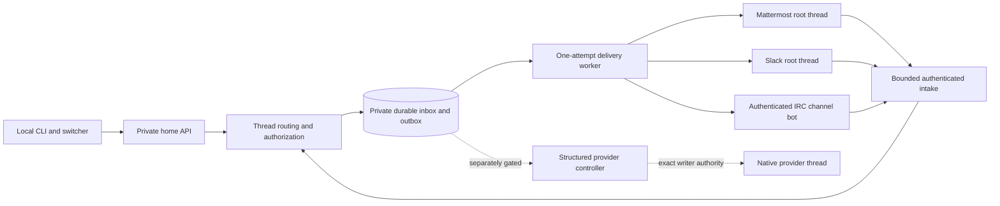

# Durable channel routing

Status: implementation contract for the next release. Keelmux v0.1.0 remains the qualified terminal release. This document does not claim live Mattermost, Slack or IRC acceptance.

The communication layer stores authored messages for a stable Keelmux thread and projects explicitly addressed replies into an external channel. Terminal output stays terminal output. A chat post receipt does not mean a provider accepted a prompt, and text received from a channel never becomes native keystrokes, an approval or a daemon command.

## Identity and ownership

A binding names the home HostID, WorkID and stable ThreadID. It also names a verified external realm, channel and root message. Native thread IDs, execution generations, processes and terminal panes remain separate. Existing session records supply the initial thread provenance; a durable conversation record then preserves that identity independently of a running process.

Bindings are immutable. Changing the target or allowed sender identities creates a new binding; disabling an old binding does not reactivate it. One external address has one active route. Address and incoming-source uniqueness include the exact provider endpoint as well as realm and channel: cloned Mattermost servers can reuse team, channel and post IDs. Mattermost realm is the verified channel's team ID, Slack realm is the authenticated workspace ID, and IRC realm is its verified TLS network authority. Mattermost and Slack require an existing verified root in the intended channel. IRC uses an explicit network bot channel; IRC has no equivalent built-in root thread in this support mode.

Inbound authorization uses exact identities from the authenticated transport: Mattermost user IDs, Slack workspace/user IDs, or IRC services accounts reported by the server. Display names and IRC nicknames are presentation. Bots, own echoes, deleted messages, and unsupported message kinds do not become new inbound authored messages. Replay is stored or deduplicated as history and never executes an action.

Each local reply names its destination binding explicitly. Multiple bindings on one Keelmux thread do not silently broadcast messages to one another. This keeps channel visibility and data sharing under the operator's control.

## Durable effects and recovery

An outgoing message and its delivery intent commit before the worker can contact an external server. The worker checks that the exact binding is active and commits an attempt before sending. A successful, matching response records the transport's stated receipt. A known rejection records failure. A timeout, disconnected socket, malformed acknowledgement or ambiguous server failure records an uncertain outcome.

An attempted operation found after daemon loss becomes uncertain. It is never returned to the send queue. Reconciliation may resolve an existing effect from authenticated matching evidence; it cannot turn an uncertain operation into a fresh send. Reusing an operation ID with different content or a different destination is a conflict. A local uniqueness constraint cannot establish exactly-once external posting.

Disabling a route blocks future claims and cancels its queued deliveries. A send already admitted can still complete externally; its receipt remains visible after disable. The implementation must record that outcome rather than inventing cancellation of an effect that may already exist.

Incoming source IDs, normalized authored messages and intake progress commit together. Intake is bounded by request size, page count, message count and time. Truncated history must be exposed explicitly; it cannot advance a completion watermark as though every message was read. Transport replay uses overlapping reads plus durable deduplication. Imported notes preserve the first observed text. A same-source edit is ignored while intake progress can advance; changes to original actor, address or creation time conflict atomically. Remote edits and deletions are outside this snapshot inbox contract and must remain visible as a coverage limit.

## Transport boundaries

Mattermost replies use `root_id` and require channel posting permission. The adapter verifies its bot identity and the existing root before activating a binding. Correlation metadata helps find a possibly created post but is not itself authorization or a durable deduplication guarantee. [Mattermost post API](https://docs.mattermost.com/api/reference/create-post), [bot accounts](https://docs.mattermost.com/developers/integrate/reference/bot-accounts).

Slack replies use the exact string `thread_ts` of the root. A receipt must name the expected channel and an exact string message timestamp. The adapter verifies the workspace and bot identity and respects the observed token's history capabilities and rate limits. It never substitutes a broader user credential when a bot is refused. [Slack posting](https://docs.slack.dev/reference/methods/chat.postMessage/), [thread history](https://docs.slack.dev/reference/methods/conversations.replies/), [pagination](https://docs.slack.dev/apis/web-api/pagination/).

IRC uses a persistent TLS connection with SASL and declared capabilities. Inbound authority requires a server-provided services account; durable deduplication requires an opaque source message ID. Labeled echo proves only server acceptance, and servers may echo a message that was subsequently blocked. Missing historical playback remains an explicit limitation; reconnecting does not imply recovered history. [IRC account tags](https://ircv3.net/specs/extensions/account-tag.html), [SASL](https://ircv3.net/specs/extensions/sasl-3.2.html), [labeled responses](https://ircv3.net/specs/extensions/labeled-response.html), [echo semantics](https://ircv3.net/specs/extensions/echo-message.html).

Credentials are local file references. Reads require an owned regular file with private permissions and a finite size, reject leaf symlinks and never repair permissions automatically. Registry records, receipts and logs contain references and public identity evidence only. TLS endpoints and certificate verification are required. Production adapters do not provide a disable-verification switch.

## Acceptance

The first slice must prove exact-root routing, sender allowlists, duplicate and bot-echo rejection, pagination bounds, operation/content conflicts, committed attempts, lost acknowledgements, daemon restart, binding disable races and private credential handling. Adapter fixtures establish protocol behavior; they do not establish acceptance on a customer's server.

Live acceptance needs a named Mattermost server/channel/root and an explicitly configured local bot. Slack and IRC receive separate named-server/client evidence before they enter the live support matrix. Automatic native model dispatch additionally needs a product structured controller, exact writer fencing and separately authorized real-turn acceptance. Until then the useful supported path is authored inbox and explicit replies with native terminal use for model interaction.
