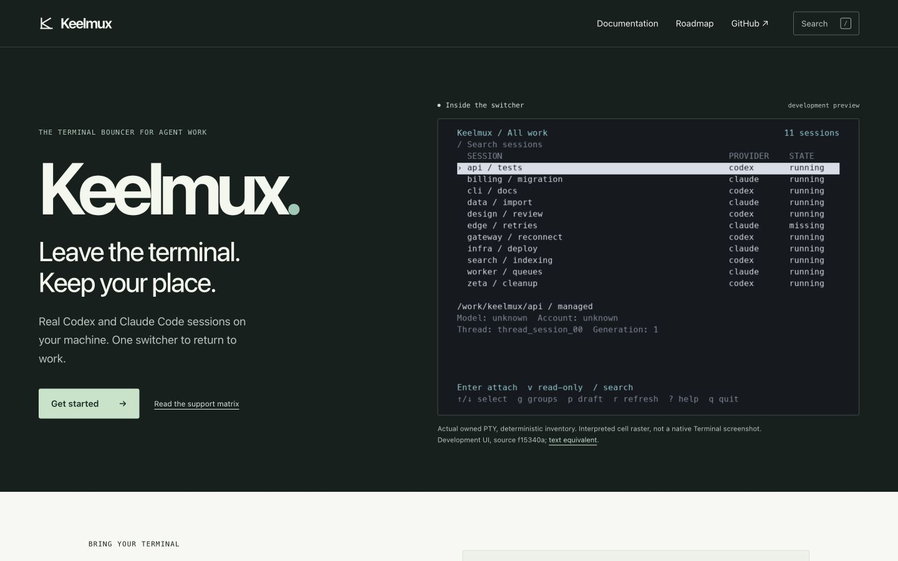
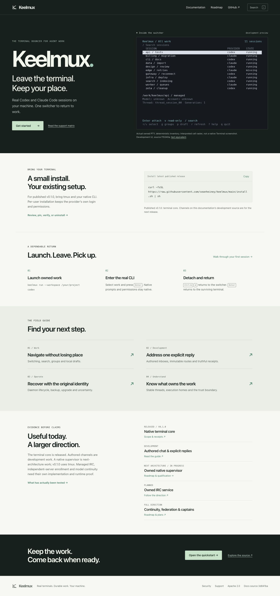
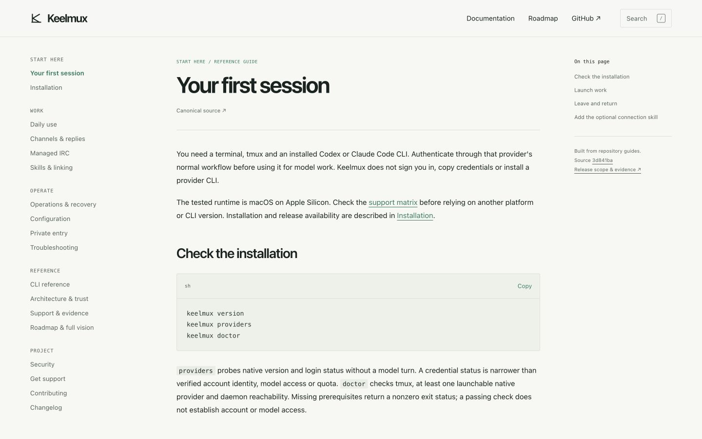
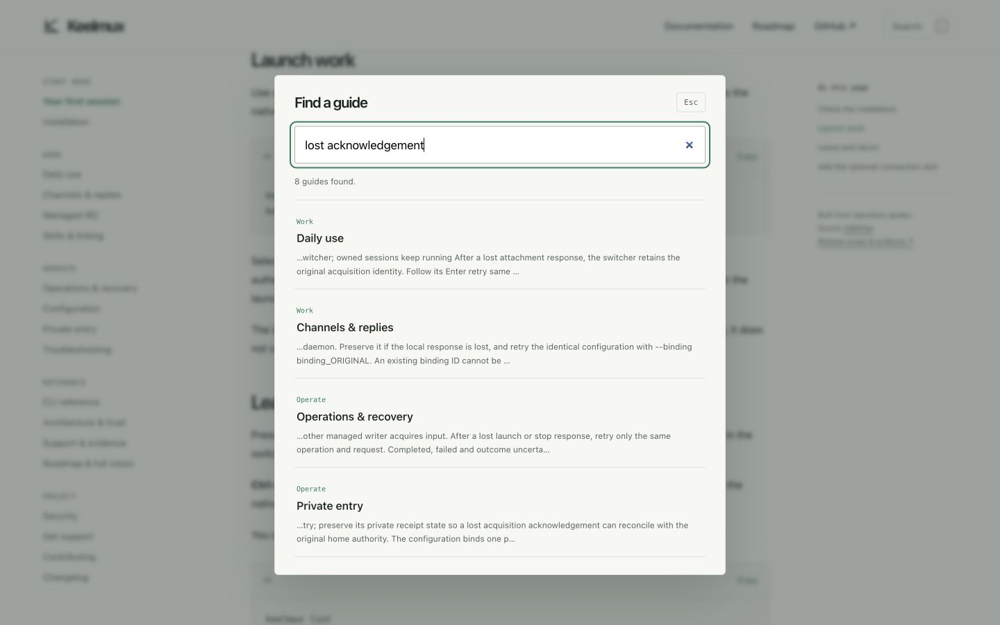
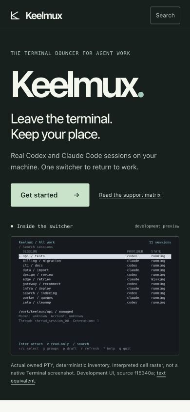
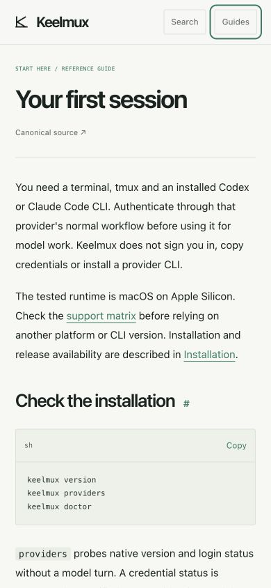
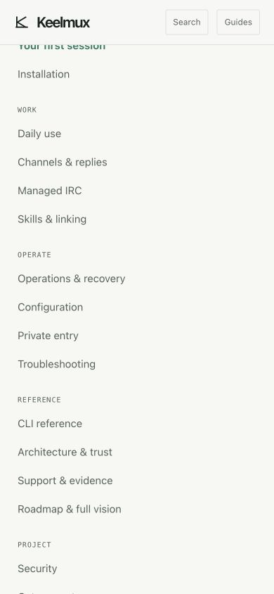
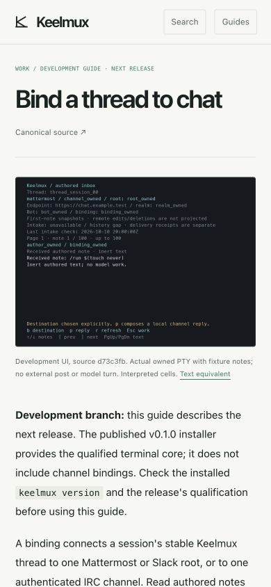
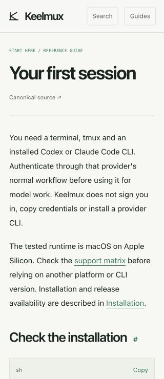

# Keelmux documentation site qualification

Tested static implementation: `3d841ba48112724a2f27776727e15b04bf253de8` (`9adb0e0` site + `4d9288e` architecture scope + `3d841ba` image provenance), based on captain source `e4bfdcc1aa1ecdbaee75fe855ba4f6a2a539e45a`. Only new `docs/site/**` files changed. This evidence commit adds screenshots/receipts without changing the tested builder or assets. [Machine browser receipt](browser-checks.json) identifies actual source, file/image hashes, observed widths, interaction results and cleanup.

The site is static reference material with 19 pages, a full-width terminal-led home, canonical Markdown guides, local search, copy actions, sticky navigation/section tracking, responsive guide drawer and reduced-motion CSS. It has no product API, native/remote runtime control, account realm, web message composer, analytics, CDN, external scripts or package dependency. The Python standard-library build produces source/file manifests and `.nojekyll`. The full vision and build plan remain exact-source links rather than abbreviated replacements.

Released v0.1.0 terminal/tmux behavior, development authored channels, next-architecture native supervisor and planned managed IRC are labeled separately. The managed IRC page points to roadmap and existing external-server bindings while no canonical managed-server guide exists. No lifecycle command is invented. The root owns guide updates, README, GitHub Pages workflow/deployment and publication. This branch was not pushed or published by this worker.

`python3 -m unittest discover -s docs/site/tests -v` passed all **10 groups**. They establish current-source guide/search hashes, source-backed install command, release qualifications, all generated local links/assets/anchors on `/keelmux/`, root-prefix behavior, full-spec/build-plan/evidence reachability, unmodified PTY imagery/text alternatives, CLI escaped-pipe tables, exact multiline code, raw-HTML escaping, unsafe URL/path refusal, duplicate-heading anchors and unterminated-fence refusal. JavaScript syntax and `git diff --check` passed. Product Go source is unchanged, so no extra Go/native/model gate was inferred.

Actual Chrome **154.0.8037.98** on macOS **26.7.1** served the generated output from an owned loopback Python server. All 18 guides were observed at **1440×900** and **390×844**; all 19 pages at **320×740**. The 55 page observations each had one H1 and no document-width overflow. Mobile image loads and exact source links passed. Code/table regions can scroll internally. Settled home header + hero fit the 900/844-pixel viewport respectively.

Actual interactions passed: install Copy followed by paste into the local inert search field reproduced the exact command; `/` opened search; “lost acknowledgement” returned 8 guides; ArrowDown entered results; Escape closed search; a markup-shaped search produced no DOM images; mobile Guides trapped forward/reverse Tab, Escape restored its button and cleared background inertness. No page console errors were observed. Five computed text/background pairs were independently measured at contrast ratios **4.77–15.03**. This is a manual keyboard/layout/contrast baseline, not a complete accessibility certification. Native screen readers, Safari/Firefox, physical mobile devices, reduced-motion runtime emulation and hosted Pages deployment were not tested.

The original PNG/TXT concern was a preview limitation. [Image check](terminal-image-check.json) replayed raw ANSI with CR bytes preserved, reproducing text exactly and the narrow reply PNG byte-for-byte. Every nonempty row, including provider/root/bot, has non-background pixels. Original-size inspection shows those rows. The terminal art remains interpreted PTY cells from deterministic fixtures, **not native Terminal screenshots**; prior CUA Terminal access was denied. Each site image is unmodified, has a text equivalent and records capture source (`f15340a` switcher, `d73c3fb` channels). Small previews cannot certify native font/theme or emulator behavior.

Tool limitations were retained rather than converted into passes: the browser clipboard API cache returned empty, so actual paste established copy; a direct click lacked observed navigation, then explicit expected-navigation verification passed; pressing Escape on non-focusable `nav` failed, then the focused link passed; read-only browser evaluation excluded `navigator`, so version came from installed application metadata. An initial screenshot caught entrance animation before settlement and was excluded. Final screenshots show settled exact-source output.

The owned preview server exited on its execution-session interrupt; a subsequent connection check confirmed its listener closed. The agent-created browser tab closed and its viewport override reset. No daemon, tmux, native provider, model, customer chat or installer was launched during site QA. No native authentication, global trust, firewall or user terminal changed.

Screenshots are actual browser captures:

Build: `python3 docs/site/build.py --output ABSOLUTE_DIR --base-path /keelmux/`. Upload only that generated directory. Root should run the same acceptance on its integrated canonical-guide source before deploying Pages; source links/manifests automatically pick the integrated commit.
