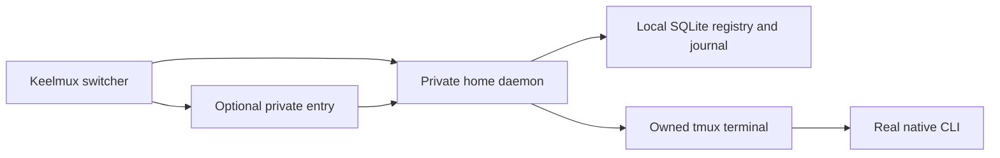

# Architecture and trust

Keelmux is a per-user terminal bouncer. Its client locates work and attaches; the home daemon owns durable registry and cooperating input authority; the terminal backend owns the native process and PTY. The vendor CLI remains authoritative for its conversation, model, login and permission behavior.

The entry routes permitted access to the home. It does not move the process, merge credentials or become that home's execution authority. Current entries use explicit private sockets and configuration; independent-server enrollment remains unfinished.

## Stable identity

| Identity | Meaning |
| --- | --- |
| Host | Execution-home authority |
| Work | Stable work identity |
| Shared thread | Stable product communication/history reference |
| Lane | Stable participant/recipient |
| Session | Navigable context for work, thread, lane and workspace |
| Execution and generation | Current run attempt and target binding |
| Native thread | Provider's own conversation, separately observed where supported |
| Runtime locator | Socket, terminal session/pane, PID, host boot and process start |

A matching directory or PID is insufficient to establish an old run. Inherited launch correlation and live owned runtime evidence are checked against the durable product identity. Ordinary terminal capability does not imply semantic prompt, approval or native history access.

## Intent before effect

The home persists an operation before attempting runtime effects. Outcomes distinguish recorded, attempted, completed, failed and uncertain. The same operation/request returns its known receipt; a conflicting reuse is refused. Reconciliation inspects exact external evidence. Missing acknowledgement is not permission to replay a launch, stop or keystroke.

The serialized service gate and existing `grants` table enforce one cooperating managed writer. A read-only client observes without owning input/size. Release verifies the exact acquisition and detached writer; stale client, token or execution generation is refused. A pending acquisition survives client loss so recovery can refer to its original authority.

## Enforcement boundary

This is cooperative control among managed clients, not an OS security sandbox. The same user can reach its own terminal socket, files and native programs outside Keelmux. Separate worktrees do not isolate ports, databases, credentials or arbitrary file writes. Native tool permissions remain native.

Credentials stay in their selected native realm. Discovery probes qualified status without copying credential stores. An account label, configured model or successful process launch is not verified effective account/model identity. Unknown values remain unknown.

Inventory, drafts, runtime receipts and logs can contain private paths or operational correlation. Federation permission, group membership and navigation are distinct: putting a session in a company group does not grant another user or peer access.

## Recovery boundaries

Client detach preserves surviving terminals. Daemon restart reconciles surviving owned processes. Provider/runtime restart and host reboot require separately tested native resume as new attempts. Missing workspace or uncertain external work remains a repair state. Restored screen/history is not proof of a live process or continued model work.

The experimental Codex broker further separates a persistent authoritative app-server from disposable native UI processes. Its grants, receipts and final output gate share the home authority. Unknown replies/callbacks are blockers and unsupported methods are denied. That internal architecture has no product launcher and does not add semantic capability to the released terminal route. See its [contract and prerequisites](../research/CODEX_BROKER_CONTRACT.md).

Keelmux's product interface stays terminal-first. TUI/native terminal, later shared chat and scoped tools use the same durable identities. A documentation site is reference material; a product web dashboard is outside the design.
